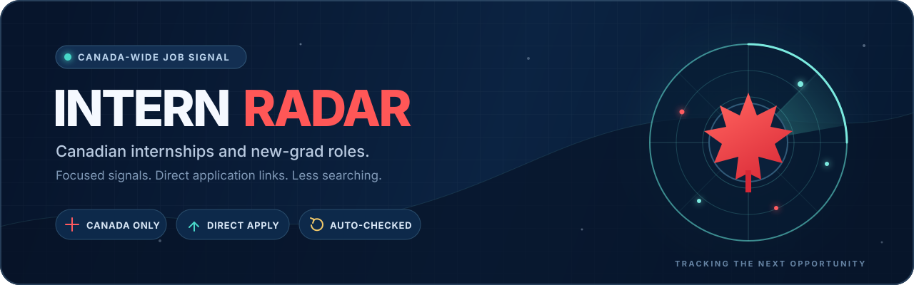

  

<h1 align="center">Canadian Internships &amp; New-Grad Roles - 2026</h1>

<strong>Canada-only internships, co-ops, and early-career roles - one overview, two focused lists.</strong>

  <a href="INTERNSHIPS.md#tech-internships"><strong>Tech internships</strong></a> 446 open
  &nbsp;&nbsp;-&nbsp;&nbsp;
  <a href="NEW_GRAD.md#tech-new-grad-roles"><strong>Tech new grad</strong></a> 83 open 
  <a href="INTERNSHIPS.md"><strong>All internships &amp; co-ops</strong></a> 1710 open
  &nbsp;&nbsp;-&nbsp;&nbsp;
  <a href="NEW_GRAD.md"><strong>All new grad &amp; early career</strong></a> 393 open

  <a href="CONTRIBUTING.md"><strong>Contributing</strong></a> -
  <a href="../../issues/new?template=suggest-listing.yml">Suggest or report a listing</a>

  
  
  
  
  

Last refreshed Oct 14, 2026 at 20:41 UTC

> [!TIP]
> 
<strong>Pick a list, then start with what changed.</strong> NEW marks roles posted in the last 7 days, and roles posted more than 180 days ago are hidden automatically. Every row is re-checked for a Canadian location before it is published.

## At a glance

| | Internships & co-ops | New grad & early career |
|---|---:|---:|
| Open roles | [1710](INTERNSHIPS.md) | [393](NEW_GRAD.md) |
| Tech roles | [446](INTERNSHIPS.md#tech-internships) | [83](NEW_GRAD.md#tech-new-grad-roles) |
| Other roles | [1264](INTERNSHIPS.md#other-internships) | [310](NEW_GRAD.md#other-early-career-roles) |
| Posted in the last 7 days | 343 | 46 |
| Hiring companies | 339 | 154 |
| Pay disclosed | 23% | 27% |
| Remote-friendly | 2 | 4 |
| Closed in the last 7 days | 164 | 32 |

## Newest roles

### Newest tech internships

**The 50 newest of 446 open tech internships**

| Company | Role | Location | Details | Posted | Apply |
|---|---|---|---|---:|---|
| Manulife Financial | NEW Summer Intern 2027 - Software Engineering | Waterloo, Ontario, CAN, Ontario, Waterloo, 500 King Street North | $52.65K/yr - Hybrid / on-site - Cover letter - Transcript | Oct 14, 2026 today | <a href="https://manulife.wd3.myworkdayjobs.com/MFCJH_adminJobs/job/Waterloo-Ontario/Summer-Intern-2027---Software-Engineering_JR26081686-1"><strong>Apply</strong></a> | <!--id:321459-->
| Generac | NEW AI Productivity &amp; Adoption, Co-op | Toronto, Canada, Canada - Toronto | $74K/yr - Co-op enrollment - Portfolio / GitHub | Oct 14, 2026 today | <a href="https://generac.wd5.myworkdayjobs.com/external/job/Toronto-Canada/AI-Productivity---Adoption--Co-op_JR15115"><strong>Apply</strong></a> | <!--id:321457-->
| Sun Life | NEW Student, AI Developer (Winter 2027) | 2 Locations, Toronto Ontario | Winter 2027 | Oct 14, 2026 today | <a href="https://sunlife.wd3.myworkdayjobs.com/Campus/job/Toronto-Ontario/AI-Developer-Co-op_JR00128581-1"><strong>Apply</strong></a> | <!--id:321456-->
| Hitachi Energy | NEW ITV Automation Specialist Intern (Winter 2027, 12months) | Toronto, Ontario, Canada, (RSBU) Toronto | Winter 2027 - $23-$30/hr - 12 month term - Co-op enrollment | Oct 14, 2026 today | <a href="https://hitachi.wd1.myworkdayjobs.com/hitachi/job/Toronto-Ontario-Canada/ITV-Automation-Specialist-Intern--Winter-2027--12months-_R0147187"><strong>Apply</strong></a> | <!--id:321453-->
| Solink | NEW Software Engineer Co-op, Apps | Ottawa Office | CA$52K - CA$68K - Canadian work authorization - Co-op enrollment - Hybrid / on-site | Oct 14, 2026 today | <a href="https://jobs.ashbyhq.com/solink/c973029a-83fa-449e-b4a9-0a1514165430"><strong>Apply</strong></a> | <!--id:320379-->
| Microsoft | NEW Stagiaire en recherche - apprentissage automatique; Research Intern - Machine Learning | Canada, Quebec, Montreal, Montreal, QC, CA | 12 week term - Cover letter | Oct 14, 2026 today | <a href="https://apply.careers.microsoft.com/careers/job/1970393557040927"><strong>Apply</strong></a> | <!--id:321469-->
| Kensington | NEW Intern - Analytics | Toronto, ON, Canada | $20/hr - Hybrid / on-site | Oct 14, 2026 today | <a href="https://job-boards.greenhouse.io/kensingtontours/jobs/5262680007"><strong>Apply</strong></a> | <!--id:321461-->
| Loto-Quebec | NEW Stage - developpeur front-end Design System | Montreal | - | Oct 14, 2026 today | <a href="https://carrieres.lotoquebec.com/tous-les-emplois/09432"><strong>Apply</strong></a> | <!--id:321445-->
| Tenstorrent | NEW Systems Intern - Validation, Software, Design, Architecture &amp; Packaging (Canada) | Toronto, Ontario, Canada; Toronto, Ontario, Canada; Vancouver, British Columbia, Canada | Hybrid / on-site | Oct 14, 2026 today | <a href="https://job-boards.greenhouse.io/tenstorrentuniversity/jobs/5264407007"><strong>Apply</strong></a> | <!--id:321419-->
| Bombardier | NEW Intern, Data Analyst (Winter 2027) | St-Laurent, QC, Canada | Winter 2027 | Oct 14, 2026 today | <a href="https://jobs.bombardier.com/job/Intern%2C-Data-Analyst-%28Winter-2027%29/16080-en_US"><strong>Apply</strong></a> | <!--id:321475-->
| Workday | NEW Software Development Engineer Intern (Canada) | Canada, BC, Vancouver | 12 month term - 6 month term - No sponsorship | Oct 13, 2026 1 day old | <a href="https://workday.wd5.myworkdayjobs.com/Workday_Early_Career/job/Canada-BC-Vancouver/Software-Development-Engineer-Intern_JR-0110807"><strong>Apply</strong></a> | <!--id:320753-->
| Workday | NEW Machine Learning Engineer Intern (Canada) | 2 Locations, Canada BC Vancouver | - | Oct 13, 2026 1 day old | <a href="https://workday.wd5.myworkdayjobs.com/Workday_Early_Career/job/Canada-BC-Vancouver/Machine-Learning-Engineer-Intern_JR-0110806"><strong>Apply</strong></a> | <!--id:320756-->
| Astera Labs | NEW Firmware Engineer Intern Fall Co-op | Vancouver. BC, Canada | $45/hr - Canadian work authorization - Co-op enrollment | Oct 13, 2026 1 day old | <a href="https://job-boards.greenhouse.io/asteraearlycareer2027/jobs/4739956005"><strong>Apply</strong></a> | <!--id:321470-->
| Astera Labs | NEW Firmware Engineer Intern Summer Co-op | Vancouver, BC, Canada | $45/hr - Canadian work authorization - Co-op enrollment | Oct 13, 2026 1 day old | <a href="https://job-boards.greenhouse.io/asteraearlycareer2027/jobs/4739957005"><strong>Apply</strong></a> | <!--id:321471-->
| Astera Labs | NEW Firmware Engineer Intern Spring Co-Op | Vancouver, BC, Canada | $45/hr - Canadian work authorization - Co-op enrollment | Oct 13, 2026 1 day old | <a href="https://job-boards.greenhouse.io/asteraearlycareer2027/jobs/4739544005"><strong>Apply</strong></a> | <!--id:321406-->
| PEBL | NEW Software Engineering, Intern | Toronto, Ontario | CA$35 per hour | Oct 13, 2026 1 day old | <a href="https://jobs.ashbyhq.com/pebl/49d8b355-620b-4dde-be4b-5489abf4c9cf"><strong>Apply</strong></a> | <!--id:321399-->
| Kensington | NEW Intern - Sales Strategy &amp; Analytics | Toronto, ON, Canada | $20/hr - Hybrid / on-site | Oct 13, 2026 1 day old | <a href="https://job-boards.greenhouse.io/kensingtontours/jobs/5264881007"><strong>Apply</strong></a> | <!--id:321393-->
| Ericsson | NEW Stagiaire developpeur DevOps chez EVCN | Montreal,Quebec,Canada, Montreal, QC, CA | 8 month term - Student status - Portfolio / GitHub | Oct 13, 2026 1 day old | <a href="https://jobs.ericsson.com/careers/job/563121777194377"><strong>Apply</strong></a> | <!--id:321407-->
| SOTI | NEW Software Developer Intern - SOTI MobiControl Apple HQ (January 2027 12 Months) | Mississauga, Canada - Meadowvale Office (HQ) | 12 month term - Co-op enrollment - Hybrid / on-site | Oct 13, 2026 1 day old | <a href="https://soti.wd3.myworkdayjobs.com/SOTI-Next-Gen/job/Mississauga-Canada--Meadowvale-Office-HQ/Software-Developer-Intern---SOTI-MobiControl-Apple-HQ--January-2027-12-Months-_R10551-2"><strong>Apply</strong></a> | <!--id:321347-->
| Rockwell Automation | NEW Co-op, Robotics Integration &amp; Development (Jan - Apr 2027) | Waterloo, Ontario, Canada, Canada-Ontario-Waterloo | Winter 2027 - $20-$32/hr - Co-op enrollment - Graduating 2027 | Oct 13, 2026 1 day old | <a href="https://rockwellautomation.wd1.myworkdayjobs.com/External-Rockwell-Automation-Early-Careers/job/Waterloo-Ontario-Canada/Co-op--Robotics-Integration-and-Development--OTTO-by-Rockwell-Automation-_R26-6721"><strong>Apply</strong></a> | <!--id:318798-->
| BMO | NEW BMO Capital Markets Investment Banking Summer 2027 Sophomore Analyst,  Infrastructure Debt Capital Markets, Toronto | Toronto, ON, CAN, FCP | Summer 2027 - $95K/yr - Canadian work authorization - Graduating 2028 | Oct 13, 2026 1 day old | <a href="https://bmo.wd3.myworkdayjobs.com/Campus/job/Toronto-ON-CAN/BMO-Capital-Markets-Summer-2027-Sophomore-Analyst--Toronto_R260028848-1"><strong>Apply</strong></a> | <!--id:321342-->
| D2L | NEW Software Developer - Winter 2027 Co-op - Vancouver | Vancouver, BC | Winter 2027 - $960-$1K CAD - Co-op enrollment - Student status | Oct 13, 2026 1 day old | <a href="https://www.d2l.com/careers/jobs/?job_id=8279317&amp;gh_jid=8279317"><strong>Apply</strong></a> | <!--id:321350-->
| Ericsson | NEW 5G Software Developer Co-oP | Ottawa,Ontario,Canada, Ottawa, ON, CA | $37/hr - 16 month term - Co-op enrollment - Student status | Oct 13, 2026 1 day old | <a href="https://jobs.ericsson.com/careers/job/563121777138098"><strong>Apply</strong></a> | <!--id:321376-->
| Aptiv | NEW Cloud Engineer Intern | CAN Kanata (2), ON - WR | - | Oct 13, 2026 1 day old | <a href="https://aptiv.wd5.myworkdayjobs.com/aptiv_careers/job/CAN-Kanata-2-ON---WR/Cloud-Engineer-Intern_J000704376"><strong>Apply</strong></a> | <!--id:321329-->
| Aptiv | NEW Cloud Software Engineer Intern | CAN Kanata (2), ON - WR | - | Oct 13, 2026 1 day old | <a href="https://aptiv.wd5.myworkdayjobs.com/aptiv_careers/job/CAN-Kanata-2-ON---WR/Cloud-Software-Engineer-Intern_J000704375"><strong>Apply</strong></a> | <!--id:321330-->
| Aptiv | NEW Cloud Engineering Intern | CAN Kanata (2), ON - WR | - | Oct 13, 2026 1 day old | <a href="https://aptiv.wd5.myworkdayjobs.com/aptiv_careers/job/CAN-Kanata-2-ON---WR/Cloud-Engineering-Intern_J000704383"><strong>Apply</strong></a> | <!--id:321325-->
| Manulife Financial | NEW Winter Co-op 2027 - Data Engineering | Waterloo, Ontario, CAN, Ontario, Waterloo, 500 King Street North | $52.65K/yr - 4 month term - Co-op enrollment - Hybrid / on-site | Oct 12, 2026 2 days old | <a href="https://manulife.wd3.myworkdayjobs.com/MFCJH_adminJobs/job/Waterloo-Ontario/Winter-Co-op-2027---Data-Engineering_JR26081660-1"><strong>Apply</strong></a> | <!--id:321318-->
| Manulife Financial | NEW Winter Co-op 2027 - Data Engineering | Toronto, Ontario, CAN, Ontario, Toronto, 200 Bloor Street East | $52.65K/yr - 4 month term - Co-op enrollment - Hybrid / on-site | Oct 12, 2026 2 days old | <a href="https://manulife.wd3.myworkdayjobs.com/MFCJH_adminJobs/job/Toronto-Ontario/Winter-Co-op-2027---Data-Engineering_JR26081658-1"><strong>Apply</strong></a> | <!--id:321317-->
| Manulife Financial | NEW Winter Co-op 2027 - AI | Toronto, Ontario, CAN, Ontario, Toronto, 200 Bloor Street East | $54.6K/yr - Co-op enrollment - Hybrid / on-site - Cover letter | Oct 12, 2026 2 days old | <a href="https://manulife.wd3.myworkdayjobs.com/MFCJH_adminJobs/job/Toronto-Ontario/Winter-Co-op-2027---AI_JR26081677-1"><strong>Apply</strong></a> | <!--id:321316-->
| Manulife Financial | NEW Winter Co-op 2027 - Software Engineering | Toronto, Ontario, CAN, Ontario, Toronto, 200 Bloor Street East | $52.65K/yr - 4 month term - Co-op enrollment - Hybrid / on-site | Oct 12, 2026 2 days old | <a href="https://manulife.wd3.myworkdayjobs.com/MFCJH_adminJobs/job/Toronto-Ontario/Winter-Co-op-2027---Software-Engineering_JR26081663-1"><strong>Apply</strong></a> | <!--id:321314-->
| Manulife Financial | NEW Winter Co-op 2027 - Software Engineering (8 Months) | Toronto, Ontario, CAN, Ontario, Toronto, 200 Bloor Street East | $52.65K/yr - 8 month term - Co-op enrollment - Hybrid / on-site | Oct 12, 2026 2 days old | <a href="https://manulife.wd3.myworkdayjobs.com/MFCJH_adminJobs/job/Toronto-Ontario/Winter-Co-op-2027---Software-Engineering--8-Months-_JR26081664-1"><strong>Apply</strong></a> | <!--id:321315-->
| Loto-Quebec | NEW Stage - intelligence artificielle | Montreal | - | Oct 10, 2026 4 days old | <a href="https://carrieres.lotoquebec.com/tous-les-emplois/09414"><strong>Apply</strong></a> | <!--id:321304-->
| Loto-Quebec | NEW Stage - amelioration continue et automatisation | Montreal | - | Oct 10, 2026 4 days old | <a href="https://carrieres.lotoquebec.com/tous-les-emplois/09363"><strong>Apply</strong></a> | <!--id:321306-->
| Loto-Quebec | NEW Stage - developpement Web frontend - projet Kopernic | Montreal | - | Oct 10, 2026 4 days old | <a href="https://carrieres.lotoquebec.com/tous-les-emplois/09354"><strong>Apply</strong></a> | <!--id:321307-->
| Loto-Quebec | NEW Stage - gouvernance de risques informationnels - coordonnateur pentest | Montreal | - | Oct 10, 2026 4 days old | <a href="https://carrieres.lotoquebec.com/tous-les-emplois/09362"><strong>Apply</strong></a> | <!--id:321303-->
| Loto-Quebec | NEW Stage - developpement, IA et automatisation | Montreal | - | Oct 10, 2026 4 days old | <a href="https://carrieres.lotoquebec.com/tous-les-emplois/09430"><strong>Apply</strong></a> | <!--id:321302-->
| Loto-Quebec | NEW Stage - analyste web | Montreal | - | Oct 10, 2026 4 days old | <a href="https://carrieres.lotoquebec.com/tous-les-emplois/09434"><strong>Apply</strong></a> | <!--id:321308-->
| BNP Paribas | NEW Machine Learning Intern - Summer 2027 | Quebec-Montreal, Canada | Summer 2027 | Oct 10, 2026 4 days old | <a href="https://www.bnpparibas.ca/en/jobs/machine-learning-intern-summer-2027/"><strong>Apply</strong></a> | <!--id:321051-->
| Acuity | NEW Stage en developpement micrologiciel/firmware | Brossard, Quebec, CA, J4Y 0C4 | - | Oct 10, 2026 4 days old | <a href="https://careers.acuityinc.com/job/Brossard-Stage-en-d%C3%A9veloppement-micrologicielfirmware-Qu%C3%A9b-J4Y-0C4/1434107300/?ats=successfactors"><strong>Apply</strong></a> | <!--id:0-->
| L3Harris Technologies | NEW Software Engineering Co-Op (Waterdown, CAN) | Waterdown, ON, CA, L9H 0C5 | Co-op enrollment | Oct 10, 2026 4 days old | <a href="https://jobs.l3harris.com/job/Waterdown-Software-Engineering-Co-Op-(Waterdown,-CAN)-ON-L9H-0C5/1430130200/?ats=successfactors"><strong>Apply</strong></a> | <!--id:0-->
| L3Harris Technologies | NEW Full Stack Developer Co-op 1 | ON, CA; Waterdown, ON, CA, L9H 0C5 | Co-op enrollment | Oct 10, 2026 4 days old | <a href="https://jobs.l3harris.com/job/Niagara-on-the-Lake-Full-Stack-Developer-Co-op-1-ON/1430141300/?ats=successfactors"><strong>Apply</strong></a> | <!--id:0-->
| Textron | NEW Stage automne 2026 - Technologie de l&#39;information des systemes de qualite / 2026 Fall Internship - Quality Systems Information Technology (Mirabel, QC) | Canada, Quebec-Mirabel | Fall 2026 | Oct 10, 2026 4 days old | <a href="https://textron.taleo.net/careersection/textron/jobdetail.ftl?job=343983"><strong>Apply</strong></a> | <!--id:0-->
| L3Harris Technologies | NEW FPGA Designer Coop (Waterdown, CAN) | Waterdown, ON, CA, L9H 0C5 | Co-op enrollment | Oct 10, 2026 4 days old | <a href="https://jobs.l3harris.com/job/Waterdown-FPGA-Designer-Coop-(Waterdown,-CAN)-ON-L9H-0C5/1430127300/?ats=successfactors"><strong>Apply</strong></a> | <!--id:0-->
| Acuity | NEW Stagiaire developpement materiel (hardware) | Brossard, Quebec, CA, J4Y 0C4 | - | Oct 10, 2026 4 days old | <a href="https://careers.acuityinc.com/job/Brossard-Stagiaire-d%C3%A9veloppement-mat%C3%A9riel-(hardware)-Qu%C3%A9b-J4Y-0C4/1433678100/?ats=successfactors"><strong>Apply</strong></a> | <!--id:0-->
| L3Harris Technologies | NEW FPGA Software Tool Developer Co-Op (Waterdown, CAN) | Waterdown, ON, CA, L9H 0C5 | Co-op enrollment | Oct 10, 2026 4 days old | <a href="https://jobs.l3harris.com/job/Waterdown-FPGA-Software-Tool-Developer-Co-Op-(Waterdown,-CAN)-ON-L9H-0C5/1430127100/?ats=successfactors"><strong>Apply</strong></a> | <!--id:0-->
| Electronic Arts | NEW C++ Software Engineer Intern (UFC - Vancouver - Summer 2027 - 8-months) | Vancouver, British Columbia, Canada | Summer 2027 - 8 month term | Oct 10, 2026 4 days old | <a href="https://jobs.ea.com/en_US/careers/JobDetail/Software-Engineer-Intern-Summer-2027-8-months-UFC/216226"><strong>Apply</strong></a> | <!--id:0-->
| Electronic Arts | NEW AI Engineer Intern | Vancouver, British Columbia, Canada | - | Oct 10, 2026 4 days old | <a href="https://jobs.ea.com/en_US/careers/JobDetail/AI-Engineer/216236"><strong>Apply</strong></a> | <!--id:0-->
| Electronic Arts | NEW AI Engineer Intern (Masters) | Vancouver, British Columbia, Canada | - | Oct 10, 2026 4 days old | <a href="https://jobs.ea.com/en_US/careers/JobDetail/AI-Engineer-Intern/216223"><strong>Apply</strong></a> | <!--id:0-->
| Electronic Arts | NEW C++ Gameplay Software Engineer Co-op (FC - Vancouver - Summer 2027 - 8-months - Undergrad) | Vancouver, British Columbia, Canada | Summer 2027 - 8 month term - Co-op enrollment | Oct 10, 2026 4 days old | <a href="https://jobs.ea.com/en_US/careers/JobDetail/Software-Engineer-Co-op/216230"><strong>Apply</strong></a> | <!--id:0-->
| Electronic Arts | NEW Software Engineer Intern | Vancouver, British Columbia, Canada | - | Oct 10, 2026 4 days old | <a href="https://jobs.ea.com/en_US/careers/JobDetail/Software-Engineer-Intern/216227"><strong>Apply</strong></a> | <!--id:0-->

<a href="INTERNSHIPS.md#tech-internships"><strong>See all 446 tech internships</strong></a> - <a href="INTERNSHIPS.md"><strong>Browse every internship &amp; co-op</strong></a> 1710 open

### Newest tech new-grad roles

**The 50 newest of 83 open tech new-grad roles**

| Company | Role | Location | Details | Posted | Apply |
|---|---|---|---|---:|---|
| OTI Lumionics | NEW Junior Mechatronics Engineer | Mississauga, ON | $65K-$90K CAD - Hybrid / on-site | Oct 13, 2026 1 day old | <a href="https://jobs.lever.co/otilumionics/9b13354b-35de-4e13-96c0-36d8f28a0fa2"><strong>Apply</strong></a> | <!--id:321391-->
| Sun Life | NEW Student, Junior Strategy Analyst (AI Strategy) (Winter 2027) | 3 Locations, Toronto Ontario | Winter 2027 | Oct 13, 2026 1 day old | <a href="https://sunlife.wd3.myworkdayjobs.com/Campus/job/Toronto-Ontario/Student--Junior-Strategy-Analyst--AI-Strategy---Winter-2027-_JR00126666"><strong>Apply</strong></a> | <!--id:321336-->
| SECURE | NEW Junior Software Developer | CA-AB-Calgary | Co-op enrollment - Possible repost | Oct 13, 2026 1 day old | <a href="https://careers-canada-secure.icims.com/jobs/2018/junior-software-developer/job?in_iframe=1"><strong>Apply</strong></a> | <!--id:321375-->
| Intuit | NEW Software Developer 1, Canada Tax Content | Toronto, Ontario, Canada | $94K-$127K/yr - Possible repost | Oct 10, 2026 4 days old | <a href="https://jobs.intuit.com/job/toronto/software-developer-1-canada-tax-content/27595/100815475200"><strong>Apply</strong></a> | <!--id:0-->
| General Dynamics Mission Systems | NEW Technical Infrastructure Analyst, Junior | Calgary, AB, Canada | - | Oct 9, 2026 5 days old | <a href="https://jobs.smartrecruiters.com/GDMSI/744000154785499"><strong>Apply</strong></a> | <!--id:320681-->
| Johnson Electric | NEW Junior Automation Systems Designer - Electrical | Canada, Ancaster, Canada Ancaster - Automation Group Canada (General) | 12 month term - Co-op enrollment - Hybrid / on-site | Oct 9, 2026 5 days old | <a href="https://johnsonelectric.wd3.myworkdayjobs.com/Career_JE/job/Canada-Ancaster/Junior-Automation-Electrical-Designer_R00031322-2"><strong>Apply</strong></a> | <!--id:320664-->
| General Dynamics Mission Systems | NEW Junior Mechanical Engineering Developer, Design (12-Month Term) | Calgary, AB, Canada | 12 month term | Oct 9, 2026 5 days old | <a href="https://jobs.smartrecruiters.com/GDMSI/744000154755004"><strong>Apply</strong></a> | <!--id:320665-->
| University of British Columbia | NEW Junior NLP Data Scientist | UBC Vancouver Campus - Vancouver, BC, Canada, UBCV \| UBC Hospital - Detwiller Pavilion (DPAV) | - | Oct 9, 2026 5 days old | <a href="https://ubc.wd10.myworkdayjobs.com/ubcstaffjobs/job/UBC-Vancouver-Campus---Vancouver-BC-Canada/Junior-NLP-Data-Scientist_JR26263"><strong>Apply</strong></a> | <!--id:320638-->
| Cisco | NEW Software Developer I (Full Time) - Canada | 2 Locations, Ottawa Ontario Canada | - | Oct 8, 2026 6 days old | <a href="https://cisco.wd5.myworkdayjobs.com/cisco_careers/job/Ottawa-Ontario-Canada/Software-Developer-I--Full-Time----Canada_2028166"><strong>Apply</strong></a> | <!--id:321055-->
| BDO Canada | NEW DevOps Engineer - New Grad (January 2027) | Toronto - Bay St | $60K-$92K/yr - Portfolio / GitHub | Oct 8, 2026 6 days old | <a href="https://bdo.wd3.myworkdayjobs.com/BDO/job/Toronto---Bay-St/DevOps-Engineer---New-Grad--January-2027-_JR7194"><strong>Apply</strong></a> | <!--id:320652-->
| TD Bank | NEW Software Engineer I - Front End | Toronto, Ontario, TD Terrace - 160 Front Street West Corporate, Toronto, Ontario | $69.7K-$98.4K/yr - Assessment likely | Oct 8, 2026 6 days old | <a href="https://td.wd3.myworkdayjobs.com/TD_Bank_Careers/job/Toronto-Ontario/Software-Engineer-I---Front-End_R_1514347"><strong>Apply</strong></a> | <!--id:321310-->
| Hunter Bond | NEW Junior Front-End Engineer - Montreal - Up to $130,000 CAD Starting Base + Exceptional Bonuses/Benefits | Montreal, Quebec, Canada | $130K/yr - Hybrid / on-site | Oct 8, 2026 6 days old | <a href="https://www.linkedin.com/jobs/view/4477119394"><strong>Apply</strong></a> | <!--id:0-->
| TD | NEW Software Engineer I | Toronto, Ontario, Canada | $69.7K/yr - Portfolio / GitHub | Oct 8, 2026 6 days old | <a href="https://www.linkedin.com/jobs/view/4476776378"><strong>Apply</strong></a> | <!--id:0-->
| Hunter Bond | NEW Graduate Software Engineer / Quant Developer / Quant Researcher - Up to $150,000 + Bonus + Benefits | Montreal, Quebec, Canada | $150K/yr - Hybrid / on-site | Oct 8, 2026 6 days old | <a href="https://www.linkedin.com/jobs/view/4477119404"><strong>Apply</strong></a> | <!--id:0-->
| Fidelity Canada | NEW Associate Full Stack Developer FCC | Vancouver, British Columbia, Canada | 25 week term - Hybrid / on-site - Portfolio / GitHub | Oct 8, 2026 6 days old | <a href="https://www.linkedin.com/jobs/view/4465932428"><strong>Apply</strong></a> | <!--id:0-->
| TD | NEW Software Engineer I - Development and Quality Engineering | Toronto, Ontario, Canada | $69.7K/yr | Oct 8, 2026 6 days old | <a href="https://www.linkedin.com/jobs/view/4476764918"><strong>Apply</strong></a> | <!--id:0-->
| COFOMO | NEW Developpeur Java junior | Montreal, Quebec, Canada | Portfolio / GitHub | Oct 8, 2026 6 days old | <a href="https://www.linkedin.com/jobs/view/4476795143"><strong>Apply</strong></a> | <!--id:0-->
| General Motors | Early Career Software Test Developer - Propulsion Thermal Management | Markham, Ontario, Canada, Markham Elevation Centre - Markham Elevation Centre | $73.9K-$110.9K/yr - Graduating 2026 - Hybrid / on-site | Oct 7, 2026 7 days old | <a href="https://generalmotors.wd5.myworkdayjobs.com/Careers_GM/job/Markham-Ontario-Canada/Early-Career-Software-Test-Developer---Propulsion-Thermal-Management_JR-202621250"><strong>Apply</strong></a> | <!--id:320511-->
| Ecolab | Junior Quality Control Software Developer | CAN - Alberta - Calgary, CAN-Calgary Plant Starfield | Co-op enrollment - Hybrid / on-site - No sponsorship | Oct 7, 2026 7 days old |  | <!--id:320695-->
| TD Bank | Software Engineer I - Development and Quality Engineering | Toronto, Ontario, TD Centre - South - 79 Wellington Street West, Toronto, Ontario | $69.7K-$98.4K/yr | Oct 7, 2026 7 days old | <a href="https://td.wd3.myworkdayjobs.com/TD_Bank_Careers/job/Toronto-Ontario/Software-Engineer-I---Development-and-Quality-Engineering_R_1514695"><strong>Apply</strong></a> | <!--id:320560-->
| Nokia | Jr. Embedded BSP SW Engineer | Canada | - | Oct 6, 2026 8 days old | <a href="https://fa-evmr-saasfaprod1.fa.ocs.oraclecloud.com/hcmUI/CandidateExperience/en/sites/CX_1/job/40110"><strong>Apply</strong></a> | <!--id:320493-->
| Motorola Solutions | Jr. Software Engineer, AI Agent Platform | Ontario Remote Work, More... | - | Oct 5, 2026 9 days old | <a href="https://motorolasolutions.wd5.myworkdayjobs.com/careers/job/Ontario-Remote-Work/Jr-Software-Engineer--AI-Agent-Platform_R66300"><strong>Apply</strong></a> | <!--id:320410-->
| Manulife Financial | Associate Applied AI Engineer - GenAI Systems | Toronto, Ontario, CAN, Ontario, Toronto, 200 Bloor Street East | - | Oct 5, 2026 9 days old | <a href="https://manulife.wd3.myworkdayjobs.com/MFCJH_Jobs/job/Toronto-Ontario/Associate-Applied-AI-Engineer---GenAI-Systems_JR26091743-2"><strong>Apply</strong></a> | <!--id:320394-->
| McKesson | Analyst, IT Vendor Management - New Grad Opportunity | CAN, ON, Mississauga, Mississauga, ON, CAN - 2300 Meadowvale Blvd (MC74) | $81.5K-$108.6K/yr - Co-op enrollment - Graduating 2026 - Portfolio / GitHub | Oct 5, 2026 9 days old | <a href="https://mckesson.wd3.myworkdayjobs.com/External_Careers/job/CAN-ON-Mississauga/Analyst--IT-Vendor-Management---New-Grad-Opportunity_JR0153988"><strong>Apply</strong></a> | <!--id:320365-->
| Scotiabank | Junior Software Engineer-Global Payments Engineering | Toronto, Ontario, Canada | - | Oct 5, 2026 9 days old | <a href="https://www.linkedin.com/jobs/view/4437568012"><strong>Apply</strong></a> | <!--id:0-->
| Aquent | Jr. E-Learning Developer w/ Rise [AQ-20875] | Toronto, Ontario, Canada | Possible repost | Oct 5, 2026 9 days old | <a href="https://www.linkedin.com/jobs/view/4473647089"><strong>Apply</strong></a> | <!--id:0-->
| Veeva Systems | Associate Software Engineer in Test | Canada - Toronto | - | Oct 2, 2026 12 days old | <a href="https://jobs.lever.co/veeva/fecaef42-b5c1-4fb2-b819-058171174ed1"><strong>Apply</strong></a> | <!--id:320332-->
| TD Bank | Software Engineer I (Cobol Developer) | Toronto, Ontario, TD Terrace - 160 Front Street West Corporate, Toronto, Ontario | $69.7K-$98.4K/yr - Portfolio / GitHub | Oct 1, 2026 13 days old | <a href="https://td.wd3.myworkdayjobs.com/TD_Bank_Careers/job/Toronto-Ontario/Software-Engineer-I--Cobol-Developer-_R_1512398"><strong>Apply</strong></a> | <!--id:320170-->
| Hunter Bond | Graduate Quant Developer / Quantitative Researcher - Competitive First Year Comp - Montreal (Hybrid) | Montreal, Quebec, Canada | Hybrid / on-site | Oct 1, 2026 13 days old | <a href="https://www.linkedin.com/jobs/view/4472620734"><strong>Apply</strong></a> | <!--id:0-->
| Analyticsmart | Junior Back-End Developer | Toronto, Ontario, Canada | - | Oct 1, 2026 13 days old | <a href="https://www.linkedin.com/jobs/view/4474135305"><strong>Apply</strong></a> | <!--id:0-->
| CGI | New Grad: AI-Assisted Full-Stack Developer | Toronto, Ontario, Canada | $50K/yr - Portfolio / GitHub - Talent pool | Oct 1, 2026 13 days old | <a href="https://www.linkedin.com/jobs/view/4474106475"><strong>Apply</strong></a> | <!--id:0-->
| TD | Software Engineer I (Cobol Developer) | Toronto, Ontario, Canada | $69.7K/yr - Portfolio / GitHub | Oct 1, 2026 13 days old | <a href="https://www.linkedin.com/jobs/view/4474133878"><strong>Apply</strong></a> | <!--id:0-->
| Solace | Junior Software Engineer | Ottawa, Ontario, Canada | $85K-$105K/yr - Hybrid / on-site - Portfolio / GitHub | Oct 1, 2026 13 days old | <a href="https://www.linkedin.com/jobs/view/4465327040"><strong>Apply</strong></a> | <!--id:0-->
| Newfold Digital | Associate Backend Engineer | Nova Scotia, Canada | - | Oct 1, 2026 13 days old | <a href="https://www.linkedin.com/jobs/view/4466459161"><strong>Apply</strong></a> | <!--id:0-->
| Ultra Maritime | Graduate Systems Engineer | Dartmouth, NS, Canada, Dartmouth (CAN) | Security clearance - Portfolio / GitHub | Sep 30, 2026 14 days old | <a href="https://ultra.wd3.myworkdayjobs.com/um-careers/job/Dartmouth-NS-Canada/Graduate-Systems-Engineer_REQ-12557"><strong>Apply</strong></a> | <!--id:320139-->
| AlayaCare | Junior Fullstack Developer (Python) | Montreal, Quebec, Canada | French / bilingual - Hybrid / on-site | Sep 30, 2026 14 days old | <a href="https://alayacare.com/open-positions?gh_jid=8858343002"><strong>Apply</strong></a> | <!--id:320137-->
| FluidAI Medical | Jr. Software Engineer - Health Systems | Kitchener, Canada | $75K-$85K/yr - Portfolio / GitHub | Sep 30, 2026 14 days old | <a href="https://ats.rippling.com/fluidai-medical-careers/jobs/68057679-c967-4707-9423-ea2db74de7c5"><strong>Apply</strong></a> | <!--id:320145-->
| EvenUp | Software Engineer (New Grad), AI Entities | Toronto, Ontario, Canada | $130K/yr | Sep 30, 2026 14 days old | <a href="https://www.linkedin.com/jobs/view/4472308332"><strong>Apply</strong></a> | <!--id:0-->
| Superhuman | Software Engineer, Full-Stack - GPTZero, Early Career | Hub - Toronto | CA$125K - CA$130K - Graduating 2026 - Hybrid / on-site | Sep 29, 2026 15 days old | <a href="https://jobs.ashbyhq.com/Superhuman%20Platform%20Inc/134c282c-2837-44a8-9f7c-74ca39486490"><strong>Apply</strong></a> | <!--id:320287-->
| Ciena | Hardware Engineer - New Grad | Ottawa, Canada- Ottawa- 383 Terry Fox- Bldg C | $62.6K-$100K/yr - Co-op enrollment | Sep 28, 2026 16 days old | <a href="https://ciena.wd5.myworkdayjobs.com/Careers/job/Ottawa/Hardware-Engineer---New-Grad_R031783"><strong>Apply</strong></a> | <!--id:320017-->
| Quora | Software Engineer New Grad, Machine Learning Platform - Quora (Remote) | Remote - Multiple Locations, United States, Canada | Graduating 2026 - Hybrid / on-site - Possible repost | Sep 25, 2026 19 days old | <a href="https://jobs.ashbyhq.com/quora/cf34f80e-fe5c-454d-bc9a-4c59993ffda0"><strong>Apply</strong></a> | <!--id:319947-->
| Loblaw Companies | Supply Chain, Business Intelligence Developer | 1 Presidents Choice Circle, Brampton, ON | $52K-$71.5K/yr - Hybrid / on-site | Sep 25, 2026 19 days old | <a href="https://myview.wd3.myworkdayjobs.com/paradox_careers/job/1-Presidents-Choice-Circle-Brampton-ON/Supply-Chain--Business-Intelligence-Developer_R2000708428"><strong>Apply</strong></a> | <!--id:319904-->
| Flexspring | AI Model Training and Deployment Developer - New Grad Opportunity | montreal, Quebec, Canada | 4 week term | Sep 25, 2026 19 days old | <a href="https://flexspring.bamboohr.com/careers/71"><strong>Apply</strong></a> | <!--id:319578-->
| Xero | Associate Engineer (Back End) | CAN: Alberta Remote Worker | $109.1K-$136.4K/yr | Sep 24, 2026 20 days old | <a href="https://jobs.ashbyhq.com/xero/8f7f41b3-85db-4029-ab1a-70c88c5dc987"><strong>Apply</strong></a> | <!--id:320770-->
| Xero | Associate Engineer (Front End) | CAN: Alberta Remote Worker | $109.1K-$136.4K/yr - Hybrid / on-site | Sep 24, 2026 20 days old | <a href="https://jobs.ashbyhq.com/xero/ea1597a0-aa1c-43e4-9195-b279f003fe08"><strong>Apply</strong></a> | <!--id:320767-->
| Amazon | Data Engineer, Early Career - 2026 (CAN) | Toronto, Ontario, Canada | Hybrid / on-site - Possible repost | Sep 24, 2026 20 days old | <a href="https://www.amazon.jobs/en/jobs/10559101"><strong>Apply</strong></a> | <!--id:319875-->
| Ericsson | Junior L1 Software Developer | Ottawa,Ontario,Canada, Ottawa, ON, CA | - | Sep 21, 2026 23 days old | <a href="https://jobs.ericsson.com/careers/job/563121775156821"><strong>Apply</strong></a> | <!--id:321045-->
| Aptiv | Associate Cloud Engineer | CAN Kanata (2), ON - WR | Hybrid / on-site | Sep 18, 2026 26 days old | <a href="https://aptiv.wd5.myworkdayjobs.com/aptiv_careers/job/CAN-Kanata-2-ON---WR/Associate-Cloud-Engineer_J000703944"><strong>Apply</strong></a> | <!--id:318861-->
| Bell | 2027 Graduate Program, Technology Services - Emerging AI and Data Solutions | Toronto, Ontario, Canada, Verdun, Quebec, Canada | 24 month term - Graduating 2027 - Hybrid / on-site | Sep 18, 2026 26 days old | <a href="https://jobs.bell.ca/ca/en/job/BECACA432894EXTERNALENCA"><strong>Apply</strong></a> | <!--id:321066-->
| Ericsson | Junior AI Developer | Ottawa,Ontario,Canada, Ottawa, ON, CA | $85K-$111.3K/yr | Sep 17, 2026 27 days old | <a href="https://jobs.ericsson.com/careers/job/563121776993236"><strong>Apply</strong></a> | <!--id:321046-->

<a href="NEW_GRAD.md#tech-new-grad-roles"><strong>See all 83 tech new-grad roles</strong></a> - <a href="NEW_GRAD.md"><strong>Browse every new-grad &amp; early-career role</strong></a> 393 open

## Where the roles are

| City or region | Internships | New grad |
|---|---:|---:|
| Greater Toronto Area | 588 | 135 |
| Greater Montreal | 369 | 37 |
| Ottawa-Gatineau | 116 | 37 |
| Calgary | 102 | 41 |
| Metro Vancouver | 92 | 42 |
| Waterloo Region | 53 | 6 |
| Halifax | 37 | 11 |
| Edmonton | 19 | 19 |
| Winnipeg | 13 | 8 |
| Quebec City | 5 | 0 |
| Remote-friendly | 2 | 4 |
| Other Canadian locations | 397 | 95 |

A role that lists several places counts once in each.

## Most active employers

| Company | Internships | New grad | Total |
|---|---:|---:|---:|
| Bombardier | 199 | 4 | 203 |
| RTX | 77 | 3 | 80 |
| PepsiCo Canada | 46 | 20 | 66 |
| Canadian Natural | 50 | 0 | 50 |
| Fleetway | 42 | 1 | 43 |
| Kent Building Supplies | 42 | 1 | 43 |
| Stantec | 14 | 27 | 41 |
| Manulife Financial | 31 | 1 | 32 |
| AMD Canada Campus | 29 | 0 | 29 |
| McElhanney | 11 | 18 | 29 |

## Upcoming internship terms

| Term | Open internships |
|---|---:|
| Fall 2026 | 13 |
| Fall/Winter 2026 | 1 |
| Winter 2027 | 645 |
| Winter/Fall 2027 | 2 |
| Winter/Summer 2027 | 4 |
| Winter/Winter 2027 | 1 |
| Spring 2027 | 4 |
| Summer 2027 | 138 |

<strong>How Intern Radar keeps the list useful</strong>

- **Source-aware:** links point to the employer's application page when available, otherwise to the original public posting.
- **Canada-first:** location eligibility is checked again at publish time, not just when a role is discovered.
- **Honest dates:** the employer's posting date is shown with its age; when unavailable, the first time the radar detected the role is used.
- **Fresh by default:** roles posted more than 180 days ago drop off every list automatically.
- **Useful details:** disclosed pay, term, eligibility, and application requirements are extracted into short, readable signals.
- **Closure tracking:** recently removed roles stay available in collapsed sections instead of overwhelming the active list.

  <a href="INTERNSHIPS.md"><strong>All internships &amp; co-ops</strong></a> 1710 open
  &nbsp;&nbsp;-&nbsp;&nbsp;
  <a href="NEW_GRAD.md"><strong>All new grad &amp; early career</strong></a> 393 open

---

  <strong>Found a missing, closed, or incorrect role?</strong> 
  <a href="../../issues/new?template=suggest-listing.yml">Send a one-minute listing report</a> - <a href="CONTRIBUTING.md">Contribution guide</a>  
  Star or watch the repository to keep the radar close when recruiting season moves fast.

