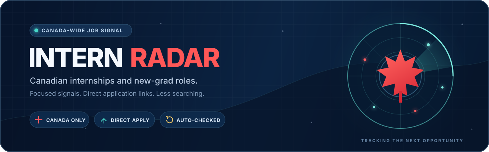

  

<h1 align="center">Canadian Internships &amp; New-Grad Roles - 2026</h1>

<strong>Canada-only internships, co-ops, and early-career roles - one overview, two focused lists.</strong>

  <a href="INTERNSHIPS.md#tech-internships"><strong>Tech internships</strong></a> 482 open
  &nbsp;&nbsp;-&nbsp;&nbsp;
  <a href="NEW_GRAD.md#tech-new-grad-roles"><strong>Tech new grad</strong></a> 101 open 
  <a href="INTERNSHIPS.md"><strong>All internships &amp; co-ops</strong></a> 1694 open
  &nbsp;&nbsp;-&nbsp;&nbsp;
  <a href="NEW_GRAD.md"><strong>All new grad &amp; early career</strong></a> 442 open

  <a href="CONTRIBUTING.md"><strong>Contributing</strong></a> -
  <a href="../../issues/new?template=suggest-listing.yml">Suggest or report a listing</a>

  
  
  
  
  

Last refreshed Nov 20, 2026 at 21:04 UTC

> [!TIP]
> 
<strong>Pick a list, then start with what changed.</strong> NEW marks roles posted in the last 7 days, and roles posted more than 180 days ago are hidden automatically. Every row is re-checked for a Canadian location before it is published.

## At a glance

| | Internships & co-ops | New grad & early career |
|---|---:|---:|
| Open roles | [1694](INTERNSHIPS.md) | [442](NEW_GRAD.md) |
| Tech roles | [482](INTERNSHIPS.md#tech-internships) | [101](NEW_GRAD.md#tech-new-grad-roles) |
| Other roles | [1212](INTERNSHIPS.md#other-internships) | [341](NEW_GRAD.md#other-early-career-roles) |
| Posted in the last 7 days | 224 | 49 |
| Hiring companies | 386 | 182 |
| Pay disclosed | 27% | 30% |
| Remote-friendly | 8 | 5 |
| Closed in the last 7 days | 259 | 64 |

## Newest roles

### Newest tech internships

**The 50 newest of 482 open tech internships**

| Company | Role | Location | Details | Posted | Apply |
|---|---|---|---|---:|---|
| Loblaw Companies | NEW Software Development - Co-op Student | 500 Lake Shore Blvd W, Toronto, ON | Winter 2027 - $35.1K-$65.7K/yr - 4 month term - Co-op enrollment | Nov 20, 2026 today | <a href="https://myview.wd3.myworkdayjobs.com/paradox_careers/job/500-Lake-Shore-Blvd-W-Toronto-ON/Software-Development---Co-op-Student_R2000695571"><strong>Apply</strong></a> | <!--id:324037-->
| Fidelity National Information Services | NEW Intern, Business Systems Analyst | CAN TRNT Virtual | 8 month term - Co-op enrollment | Nov 20, 2026 today | <a href="https://fis.wd5.myworkdayjobs.com/searchjobs/job/CAN-TRNT-Virtual/Intern--Business-Systems-Analyst_JR0308628"><strong>Apply</strong></a> | <!--id:324008-->
| Altera Corporation | NEW FPGA Software Engineer Intern | Toronto, Ontario, Canada | $95K-$100K/yr | Nov 20, 2026 today | <a href="https://altera.wd1.myworkdayjobs.com/altera/job/Toronto-Ontario-Canada/FPGA-Software-Engineer-Intern_R03445"><strong>Apply</strong></a> | <!--id:324005-->
| Microsoft | NEW Research Intern - AI Serving Systems and Hardware - Microsoft Research | Canada, British Columbia, Vancouver, Vancouver, BC, CA | Fall - $10.17K/mo - 12 week term - Student status | Nov 19, 2026 1 day old | <a href="https://apply.careers.microsoft.com/careers/job/1970393557076203"><strong>Apply</strong></a> | <!--id:324014-->
| MDA | NEW Engineering Student - AI/ML Specialist - Winter 2027 | Richmond, BC, Canada | Winter 2027 | Nov 19, 2026 1 day old | <a href="https://recruiting.ultipro.ca/MAC5000MCDW/JobBoard/7667adcc-47ae-477a-9183-0d8ef8bc0748/OpportunityDetail?opportunityId=b5aef546-676b-4f7a-8c20-acfa8f25069f"><strong>Apply</strong></a> | <!--id:324016-->
| Ross Video | Research Assistant Co-op - AI Focus (Winter Term- January 2027 - April 2027) | Hybrid Remote , Nepean, Ontario | Co-op enrollment - Hybrid / on-site | - | <a href="https://jobs.jobvite.com/ross-video-careers/job/o51QAfwg"><strong>Apply</strong></a> | <!--id:323976-->
| Georgian Partners Growth | NEW Physical AI &amp; Robotics Intern (2027) | Toronto Headquarters | Portfolio / GitHub - Talent pool | Nov 19, 2026 1 day old | <a href="https://jobs.ashbyhq.com/georgian/62da47ff-0424-4e28-bffa-cff0de8ca228"><strong>Apply</strong></a> | <!--id:323972-->
| Revvity | NEW Full-stack AI Developer Intern | CAD Remote - ON | Possible repost | Nov 19, 2026 1 day old | <a href="https://revvity.wd103.myworkdayjobs.com/External/job/CAD-Remote--ON/Full-stack-AI-Developer-Intern_JR-045796"><strong>Apply</strong></a> | <!--id:323957-->
| Alberta Investment Management Corporation | NEW Intern, Test Automation (12-month term) | Edmonton | 12 month term - Student status - Possible repost | Nov 19, 2026 1 day old | <a href="https://aimco.wd10.myworkdayjobs.com/AIMCoCareers/job/Edmonton/Intern--Test-Automation--12-month-term-_JR100958"><strong>Apply</strong></a> | <!--id:323954-->
| Workstream | NEW Full Stack Engineer Intern | Vancouver | 12 month term - Co-op enrollment - Hybrid / on-site | Nov 19, 2026 1 day old | <a href="https://job-boards.greenhouse.io/workstream/jobs/6265872004"><strong>Apply</strong></a> | <!--id:323958-->
| e-STORAGE | NEW Data Engineering Intern | Kitchener, Ontario, Canada | $20-$25/hr | Nov 19, 2026 1 day old | <a href="https://www.linkedin.com/jobs/view/4491616881"><strong>Apply</strong></a> | <!--id:0-->
| Motorola Solutions | NEW Software Development 2026 Co-Op | Concord, Ontario, Canada | Co-op enrollment | Nov 19, 2026 1 day old | <a href="https://www.linkedin.com/jobs/view/4492463273"><strong>Apply</strong></a> | <!--id:0-->
| Simon-Kucher | NEW Summer 2027 Intern - Elevate/Data Science [UG/Masters] | Toronto, Ontario, Canada | Summer 2027 - 9 week term - Student status - Talent pool | Nov 19, 2026 1 day old | <a href="https://www.linkedin.com/jobs/view/4437291302"><strong>Apply</strong></a> | <!--id:0-->
| Alberta Investment Management Corporation (AIMCo) | NEW Intern, Test Automation (12-month term) | Edmonton, Alberta, Canada | 12 month term | Nov 19, 2026 1 day old | <a href="https://www.linkedin.com/jobs/view/4491899941"><strong>Apply</strong></a> | <!--id:0-->
| Staffline Solutions | NEW Data Analytics Intern | Canada | - | Nov 19, 2026 1 day old | <a href="https://www.linkedin.com/jobs/view/4492155674"><strong>Apply</strong></a> | <!--id:0-->
| Talent Place Consultancy | NEW Business Analytics Intern | Canada | - | Nov 19, 2026 1 day old | <a href="https://www.linkedin.com/jobs/view/4492168294"><strong>Apply</strong></a> | <!--id:0-->
| Saputo Inc. | NEW Intern, Packaging Data and Sustainability | Montreal, Quebec, Canada | $21.9/hr - French / bilingual - Portfolio / GitHub | Nov 19, 2026 1 day old | <a href="https://www.linkedin.com/jobs/view/4492294145"><strong>Apply</strong></a> | <!--id:0-->
| Dana Incorporated | NEW Electrical Design and Embedded Software Engineering Intern | Boucherville, Quebec, Canada | French / bilingual | Nov 19, 2026 1 day old | <a href="https://www.linkedin.com/jobs/view/4484747391"><strong>Apply</strong></a> | <!--id:0-->
| Dana Incorporated | NEW Stagiaire -Design Electrique et Logiciel embarque | Boucherville, Quebec, Canada | - | Nov 19, 2026 1 day old | <a href="https://www.linkedin.com/jobs/view/4484740555"><strong>Apply</strong></a> | <!--id:0-->
| CAE | NEW Stagiaire - Intelligence artificielle | Montreal, Quebec, Canada | Co-op enrollment - Student status | Nov 19, 2026 1 day old | <a href="https://www.linkedin.com/jobs/view/4476360074"><strong>Apply</strong></a> | <!--id:0-->
| Roblox | NEW [Summer 2027 Canada] Software Engineer Intern, Engine | Vancouver, British Columbia, Canada | Summer 2027 - $52 CAD - 12 week term - Hybrid / on-site | Nov 18, 2026 2 days old | <a href="https://careers.roblox.com/jobs/8386080?gh_jid=8386080"><strong>Apply</strong></a> | <!--id:323938-->
| symplistic.ai | NEW AI Software Engineer - 12 Month Co-op | Vaughan, ON, Canada | Winter 2027 - $21-$23/hr - 12 month term - Co-op enrollment | Nov 18, 2026 2 days old | <a href="https://ca.indeed.com/viewjob?jk=7cc54dabc5339ff3"><strong>Apply</strong></a> | <!--id:0-->
| ESS Technology, Inc. | NEW Junior Embedded Firmware Engineer - Co-op (Intern) | Kelowna, British Columbia, Canada | Co-op enrollment | Nov 18, 2026 2 days old | <a href="https://www.linkedin.com/jobs/view/4492066283"><strong>Apply</strong></a> | <!--id:0-->
| Guardian Capital Group | NEW Data Science Intern (Summer 2027) | Toronto, Ontario, Canada | Summer 2027 - $25-$35/hr - Student status - Portfolio / GitHub | Nov 18, 2026 2 days old | <a href="https://www.linkedin.com/jobs/view/4491337324"><strong>Apply</strong></a> | <!--id:0-->
| Bell Flight | NEW Stage hiver 2027 - Technologie de l&#39;information des systemes de qualite / 2027 Winter Internship - Quality Systems Information Technology (Mirabel, QC) | Mirabel, Quebec, Canada | Winter 2027 - Co-op enrollment | Nov 18, 2026 2 days old | <a href="https://www.linkedin.com/jobs/view/4491864724"><strong>Apply</strong></a> | <!--id:0-->
| CAE | NEW Stagiaire - Developpeur Full Stack-EN | Montreal, Quebec, Canada | - | Nov 18, 2026 2 days old | <a href="https://www.linkedin.com/jobs/view/4474089245"><strong>Apply</strong></a> | <!--id:0-->
| Autodesk | NEW Stagiaire,en developpement IA (Ete 2027)/ Intern, AI Developer (Summer 2027) | Montreal, Quebec, Canada | Summer 2027 - 16 week term - Hybrid / on-site - Student status | Nov 18, 2026 2 days old | <a href="https://www.linkedin.com/jobs/view/4492107122"><strong>Apply</strong></a> | <!--id:0-->
| Textron | NEW Stage hiver 2027 - Technologie de l&#39;information des systemes de qualite / 2027 Winter Internship - Quality Systems Information Technology (Mirabel, QC) | Mirabel, Quebec, Canada | Winter 2027 - Co-op enrollment | Nov 18, 2026 2 days old | <a href="https://www.linkedin.com/jobs/view/4491310301"><strong>Apply</strong></a> | <!--id:0-->
| CAE | NEW Stagiaire - Intelligence artificielle-EN | Montreal, Quebec, Canada | - | Nov 18, 2026 2 days old | <a href="https://www.linkedin.com/jobs/view/4474089246"><strong>Apply</strong></a> | <!--id:0-->
| TMX Group | NEW DevOps Analyst Intern | Montreal - 1190 av. des Canadiens-de-Montreal | 4 month term - Hybrid / on-site - Portfolio / GitHub | Nov 17, 2026 3 days old | <a href="https://tmx.wd3.myworkdayjobs.com/TMX_Careers/job/Montreal---1190-av-des-Canadiens-de-Montreal/DevOps-Analyst-Intern_R-6724"><strong>Apply</strong></a> | <!--id:323884-->
| SOTI | NEW Software Developer in Test Intern (May 2027 12 Months) | Mississauga, Canada - Meadowvale Office (HQ) | 12 month term | Nov 17, 2026 3 days old | <a href="https://soti.wd3.myworkdayjobs.com/SOTI-Next-Gen/job/Mississauga-Canada--Meadowvale-Office-HQ/Software-Developer-in-Test-Intern--May-2027-12-Months-_R10676"><strong>Apply</strong></a> | <!--id:323882-->
| Saputo | NEW Intern, Data Engineer Enterprise Analytics | Mississauga, ON, Georgetown | $21.9/hr - Portfolio / GitHub | Nov 17, 2026 3 days old | <a href="https://saputo.wd5.myworkdayjobs.com/saputo_external_careers/job/Mississauga-ON/Intern--Data-Engineer-Enterprise-Analytics_JR68381"><strong>Apply</strong></a> | <!--id:323859-->
| AtkinsRealis | NEW Rail Infrastructure Co-Op Student | CA.ON.Toronto.191 The West Mall | Winter 2027 - $26-$29/hr - Co-op enrollment - Hybrid / on-site | Nov 17, 2026 3 days old | <a href="https://slihrms.wd3.myworkdayjobs.com/careers/job/CAONToronto191-The-West-Mall/Rail-Infrastructure-Co-Op-Student_R-164340"><strong>Apply</strong></a> | <!--id:323845-->
| Stantec | NEW Co-op Student - Quality Assurance (French Bilingual ) (8-12 Month Term) | Edmonton, AB, Canada | 12 month term - Co-op enrollment - French / bilingual | Nov 17, 2026 3 days old | <a href="https://hdhl.fa.us6.oraclecloud.com/hcmUI/CandidateExperience/en/sites/CX_1/job/1008646"><strong>Apply</strong></a> | <!--id:323915-->
| Qualcomm | NEW FY27 Intern - AI/Machine Learning Internship Internship - Canada (16 months) | Markham, Ontario, Canada, Markham, ON, CA | $54.6K-$103.35K/yr - 16 month term - Graduating 2028 - Assessment likely | Nov 17, 2026 3 days old | <a href="https://qualcomm.eightfold.ai/careers/job/446722176432"><strong>Apply</strong></a> | <!--id:323897-->
| Angel Host | NEW AI Product Engineer Intern Co-op | Montreal, QC | Co-op enrollment | Nov 17, 2026 3 days old | <a href="https://angelhost.bamboohr.com/careers/123/"><strong>Apply</strong></a> | <!--id:0-->
| Birdseye Security Solutions | NEW Computer Vision Intern | Mississauga, ON | - | Nov 17, 2026 3 days old | <a href="https://birdseyeaccount.bamboohr.com/careers/289/"><strong>Apply</strong></a> | <!--id:0-->
| Birdseye Security Solutions | NEW AI Systems Intern | Mississauga, ON | - | Nov 17, 2026 3 days old | <a href="https://birdseyeaccount.bamboohr.com/careers/287/"><strong>Apply</strong></a> | <!--id:0-->
| Birdseye Security Solutions | NEW Software Developer Intern | Mississauga, ON | - | Nov 17, 2026 3 days old | <a href="https://birdseyeaccount.bamboohr.com/careers/286/"><strong>Apply</strong></a> | <!--id:0-->
| Xradar | NEW Software Engineer Co-op (Winter 2027) | Burnaby, BC | Winter 2027 - Co-op enrollment | Nov 17, 2026 3 days old | <a href="https://xradar.bamboohr.com/careers/203/"><strong>Apply</strong></a> | <!--id:0-->
| BNP Paribas | Portfolio Analytics &amp; Modelling Intern - Summer 2027 | Quebec-Montreal, Canada | Summer 2027 - Portfolio / GitHub | - | <a href="https://www.bnpparibas.ca/en/jobs/portfolio-analytics-modelling-intern-summer-2027/"><strong>Apply</strong></a> | <!--id:323841-->
| Lumentum | NEW AI Engineer - Co-op/Intern | Canada - Ottawa (Bill Leathem) | $24-$35/hr - 12 month term - Co-op enrollment - Hybrid / on-site | Nov 16, 2026 4 days old | <a href="https://lumentum.wd5.myworkdayjobs.com/LITE/job/Canada---Ottawa-Bill-Leathem/AI-Engineer---Co-op-Intern_20261778"><strong>Apply</strong></a> | <!--id:323829-->
| Marvell | NEW System Engineer - Optical DSP Intern (PhD) - Co-Op 2027 | 2 Locations, CA ON Ontario Toronto | Fall 2027 - Co-op enrollment - Graduating 2027 - Portfolio / GitHub | Nov 16, 2026 4 days old | <a href="https://marvell.wd1.myworkdayjobs.com/MarvellCareers/job/CA-ON---Ontario---Toronto/System-Engineer---Optical-DSP-Intern--PhD----Co-Op-2027_2604424"><strong>Apply</strong></a> | <!--id:323818-->
| Videotron | NEW Stagiaire informatique | Montreal, QC, Canada, Remote | Remote | Nov 16, 2026 4 days old | <a href="https://jobs.smartrecruiters.com/Videotron/744000161909378"><strong>Apply</strong></a> | <!--id:323840-->
| CIBC | NEW Global Investment Banking, Summer 2028 Analyst (Calgary - Energy &amp; Infrastructure) | Calgary, AB, Calgary-855 2 ST SW,  9th | Summer 2028 - $105K/yr - 4 month term - Hybrid / on-site | Nov 16, 2026 4 days old | <a href="https://cibc.wd3.myworkdayjobs.com/campus/job/Calgary-AB/Global-Investment-Banking--Student-Analyst_2623655"><strong>Apply</strong></a> | <!--id:323799-->
| SAP IT Business Systeme | NEW SAP iXp Intern - Data &amp; Platform, Technical Support | Vancouver, BC, Canada | - | Nov 16, 2026 4 days old | <a href="https://jobs.smartrecruiters.com/SAPITBusinessSysteme/744000161864589"><strong>Apply</strong></a> | <!--id:323805-->
| Saputo | NEW Intern, Automation &amp; Operational Technology | Saint-Laurent, QC, Head Office - Canadian Division (35) | $21.9/hr - French / bilingual - Portfolio / GitHub | Nov 16, 2026 4 days old | <a href="https://saputo.wd5.myworkdayjobs.com/saputo_external_careers/job/Saint-Laurent-QC/Intern--Automation---Operational-Technology_JR68363"><strong>Apply</strong></a> | <!--id:323768-->
| Saputo | NEW Intern, Packaging Data and Sustainability | Saint-Leonard, QC, Saint-Leonard | French / bilingual - Portfolio / GitHub | Nov 16, 2026 4 days old | <a href="https://saputo.wd5.myworkdayjobs.com/saputo_external_careers/job/Saint-Leonard-QC/Stagiaire--dveloppement-durable-et-emballage_JR68362"><strong>Apply</strong></a> | <!--id:323767-->
| SAP IT Business Systeme | NEW SAP iXp Intern - Full-stack Software Developer | Vancouver, BC, Canada | - | Nov 16, 2026 4 days old | <a href="https://jobs.smartrecruiters.com/SAPITBusinessSysteme/744000161851189"><strong>Apply</strong></a> | <!--id:323790-->
| Shopify | NEW Software Engineer Intern (Summer 2027) | Montreal, QC / Toronto, ON / Ottawa, ON | Summer 2027 | Nov 16, 2026 4 days old | <a href="https://www.shopify.com/careers/can-software-engineering-internships-summer-2027_7ebb28da-0f4a-40ae-b41f-f5de60f3ca2a"><strong>Apply</strong></a> | <!--id:0-->

<a href="INTERNSHIPS.md#tech-internships"><strong>See all 482 tech internships</strong></a> - <a href="INTERNSHIPS.md"><strong>Browse every internship &amp; co-op</strong></a> 1694 open

### Newest tech new-grad roles

**The 50 newest of 101 open tech new-grad roles**

| Company | Role | Location | Details | Posted | Apply |
|---|---|---|---|---:|---|
| Sanofi | NEW 2027 Digital Graduate Program, Product Analyst, Data and AI Engineer | Toronto, ON, Toronto | Co-op enrollment - Hybrid / on-site - Talent pool | Nov 20, 2026 today | <a href="https://sanofi.wd3.myworkdayjobs.com/SanofiCareers/job/Toronto-ON/XMLNAME-2027-Digital-Graduate-Program--Product-Analyst--Data-and-AI-Engineer_R2876172-1"><strong>Apply</strong></a> | <!--id:324031-->
| Ciena | NEW Embedded Software Developer - New Grad | Ottawa, Canada- Ottawa- 385 Terry Fox- Bldg B | $76.2K-$121.8K/yr - Co-op enrollment | Nov 20, 2026 today | <a href="https://ciena.wd5.myworkdayjobs.com/Careers/job/Ottawa/Embedded-Software-Developer---New-Grad_R032147"><strong>Apply</strong></a> | <!--id:324018-->
| Gradient MSP | NEW Junior Full Stack Developer | Canada | - | Nov 19, 2026 1 day old | <a href="https://www.linkedin.com/jobs/view/4492187064"><strong>Apply</strong></a> | <!--id:0-->
| Atlassian | NEW Software Engineer, 2027 Graduate Canada | Canada | $94.5K/yr - Graduating 2027 - Hybrid / on-site - Student status | Nov 19, 2026 1 day old | <a href="https://www.linkedin.com/jobs/view/4467794140"><strong>Apply</strong></a> | <!--id:0-->
| Ciena | NEW Routing/IP Software Engineer - New Grad | Ottawa, Ontario, Canada | $71.9K-$114.9K/yr - Co-op enrollment - Hybrid / on-site - Portfolio / GitHub | Nov 19, 2026 1 day old | <a href="https://www.linkedin.com/jobs/view/4484107617"><strong>Apply</strong></a> | <!--id:0-->
| Sun Life | NEW Student, Associate Front-End Developer (Winter 2027) | 2 Locations, Sun Life Toronto One York | Winter 2027 - Co-op enrollment - Graduating 2027 - Hybrid / on-site | Nov 18, 2026 2 days old | <a href="https://sunlife.wd3.myworkdayjobs.com/Campus/job/Sun-Life-Toronto-One-York/Student--Associate-Front-End-Developer--Winter-2027-_JR00127140"><strong>Apply</strong></a> | <!--id:323924-->
| IQVIA | NEW Scientifique des donnees associe, confidentialite et desidentification/ Associate Data Scientist, Privacy and De-identification | Ottawa, Ontario, Canada | $49.7K-$82.8K/yr - Assessment likely | Nov 18, 2026 2 days old | <a href="https://iqvia.wd1.myworkdayjobs.com/IQVIA/job/Ottawa-Ontario-Canada/Scientifique-des-donnes-associ--confidentialit-et-dsidentification--Associate-Data-Scientist--Privacy-and-De-identification_R1569255"><strong>Apply</strong></a> | <!--id:323902-->
| Sunlife | NEW Student, Associate Front-End Developer (Winter 2027) | North York, Ontario, Canada | Winter 2027 - Co-op enrollment - Graduating 2027 - Hybrid / on-site | Nov 18, 2026 2 days old | <a href="https://www.linkedin.com/jobs/view/4492071600"><strong>Apply</strong></a> | <!--id:0-->
| DaoAI | NEW Junior Full Stack Engineer - Wemio | Vancouver, British Columbia, Canada | $60K/yr - Hybrid / on-site | Nov 18, 2026 2 days old | <a href="https://www.linkedin.com/jobs/view/4491887680"><strong>Apply</strong></a> | <!--id:0-->
| Tower Research Capital | NEW Developpeur de logiciels C++ nouvellement diplome / New Grad C++ Software Developer | Montreal, Quebec, Canada | - | Nov 18, 2026 2 days old | <a href="https://www.linkedin.com/jobs/view/4466523490"><strong>Apply</strong></a> | <!--id:0-->
| Generac | NEW Associate Hardware Engineer | Toronto, Canada, Canada - Toronto | $80K-$100K/yr - Co-op enrollment | Nov 17, 2026 3 days old | <a href="https://generac.wd5.myworkdayjobs.com/external/job/Toronto-Canada/Associate-Hardware-Engineer_JR18473"><strong>Apply</strong></a> | <!--id:323871-->
| Sony Pictures Imageworks | NEW Infrastructure - Developpeur(euse) de logiciel/ Infrastructure - Associate Software Developer | Montreal, Quebec, Canada | French / bilingual - Talent pool | Nov 17, 2026 3 days old | <a href="https://job-boards.greenhouse.io/sonypicturesimageworks/jobs/8207497003"><strong>Apply</strong></a> | <!--id:323979-->
| Sony Pictures Imageworks | NEW Associate Software Engineer | Vancouver, British Columbia, Canada | $67.2K-$89K/yr - Talent pool | Nov 17, 2026 3 days old | <a href="https://job-boards.greenhouse.io/sonypicturesimageworks/jobs/8207482003"><strong>Apply</strong></a> | <!--id:323977-->
| TD Bank | NEW Software Engineer I (Full Stack) | Toronto, Ontario, TD Terrace - 160 Front Street West Corporate, Toronto, Ontario | $69.7K-$98.4K/yr - Portfolio / GitHub - Talent pool | Nov 17, 2026 3 days old | <a href="https://td.wd3.myworkdayjobs.com/TD_Bank_Careers/job/Toronto-Ontario/Software-Engineer-I--Full-Stack-_R_1518503-1"><strong>Apply</strong></a> | <!--id:323962-->
| American Express | NEW Campus Undergraduate Full-Time Engineer - 2027 Software Engineer I, Enterprise Technology Services- Toronto, Ontario, Canada | Toronto, ON, Canada | - | Nov 16, 2026 4 days old | <a href="https://egug.fa.us2.oraclecloud.com/hcmUI/CandidateExperience/en/sites/CX_1/job/26016677"><strong>Apply</strong></a> | <!--id:323791-->
| Joblet-AI | NEW Junior Software Engineer (Remote) | Canada | - | Nov 16, 2026 4 days old | <a href="https://www.linkedin.com/jobs/view/4490624213"><strong>Apply</strong></a> | <!--id:0-->
| Xennial | NEW Associate Full Stack Engineer | North York, Ontario, Canada | $50K-$60K/yr - Hybrid / on-site | Nov 16, 2026 4 days old | <a href="https://www.linkedin.com/jobs/view/4490684767"><strong>Apply</strong></a> | <!--id:0-->
| Citi | Junior Developer | Mississauga Ontario Canada, 5900 HURONTARIO STREET  MISSISSAUGA | $79.32K-$110.68K/yr | Nov 13, 2026 7 days old | <a href="https://citi.wd5.myworkdayjobs.com/2/job/Mississauga-Ontario-Canada/Junior-Developer_261007699-1"><strong>Apply</strong></a> | <!--id:323803-->
| DataVisor | Infrastructure Engineer, Junior / New Grad (Toronto) | Toronto, Ontario, Canada, Remote | Remote | Nov 13, 2026 7 days old | <a href="https://apply.workable.com/datavisor-jobs/j/14ABD92A86/"><strong>Apply</strong></a> | <!--id:323766-->
| Affirm | Software Engineer I, Backend (Continuous Delivery) | Remote Canada | $101K-$151K/yr - Remote | Nov 12, 2026 8 days old | <a href="https://job-boards.greenhouse.io/affirm/jobs/8181185003"><strong>Apply</strong></a> | <!--id:323696-->
| AlayaCare | Developpeur fullstack junior (Python) | Greater Montreal Metropolitan Area | - | Nov 12, 2026 8 days old | <a href="https://www.linkedin.com/jobs/view/4472634862"><strong>Apply</strong></a> | <!--id:0-->
| Ciena | Embedded Software Engineer - New Grad | Ottawa, Canada- Ottawa- 385 Terry Fox- Bldg B | $72K-$115K/yr - Co-op enrollment - Graduating 2027 - Portfolio / GitHub | Nov 11, 2026 9 days old | <a href="https://ciena.wd5.myworkdayjobs.com/Careers/job/Ottawa/Embedded-Software-Engineer---New-Grad_R032090-1"><strong>Apply</strong></a> | <!--id:323599-->
| Nutanix | Forward Deployed Engineer - Ph.D. Early Career - AI Inference | Vancouver, British Columbia | - | - | <a href="https://jobs.jobvite.com/nutanix/job/oLmVAfwm"><strong>Apply</strong></a> | <!--id:323500-->
| Bank of Montreal | Software Developer (New or Recent Graduate) | Toronto, ON, CAN, FCP | $55.5K-$120K/yr - Student status | Nov 9, 2026 11 days old | <a href="https://bmo.wd3.myworkdayjobs.com/External/job/Toronto-ON-CAN/Software-Developer_R260028581"><strong>Apply</strong></a> | <!--id:323287-->
| BIS Safety Software | Junior Data Analyst | Sherwood Park, Alberta | $60K-$65K CAD - Hybrid / on-site | Nov 9, 2026 11 days old | <a href="https://jobs.lever.co/bis/ce37713b-9922-4a73-999a-f0b8e544540b"><strong>Apply</strong></a> | <!--id:323985-->
| CSC Generation | Junior Software Engineer | Remote - Toronto | 6 month term - Portfolio / GitHub | Nov 9, 2026 11 days old | <a href="https://jobs.lever.co/cscgeneration-2/61ba3ce6-b92b-45b4-932d-0c66e5e19185"><strong>Apply</strong></a> | <!--id:323331-->
| Wonderbrands | Fullstack Software Developer (Open to New Grads) - Hybrid | Etobicoke, Ontario, Canada | Hybrid / on-site - Student status | Nov 9, 2026 11 days old | <a href="https://www.linkedin.com/jobs/view/4481204483"><strong>Apply</strong></a> | <!--id:0-->
| OBD Experts | Junior Software Engineer - On-site (Vancouver Area) | Vancouver, British Columbia, Canada | $80K-$90K/yr - Canadian work authorization - Citizenship required - Hybrid / on-site | Nov 8, 2026 12 days old | <a href="https://www.linkedin.com/jobs/view/4487354720"><strong>Apply</strong></a> | <!--id:0-->
| Hootsuite | Junior Software Developer | Toronto, Ontario, Canada, Vancouver, British Columbia, Canada | $68K-$95K CAD - Co-op enrollment - Remote | Nov 6, 2026 14 days old | <a href="https://job-boards.greenhouse.io/hootsuite/jobs/8359647"><strong>Apply</strong></a> | <!--id:323147-->
| Valsoft | Ingenieur.e IA I \| AI Engineer I | Saint-Laurent, Quebec, Canada | - | Nov 6, 2026 14 days old | <a href="https://apply.workable.com/valsoft-corp/j/D0C585CAB5/"><strong>Apply</strong></a> | <!--id:323178-->
| Rose Rocket | Junior Software Engineer | Toronto | $72K-$88K/yr - Hybrid / on-site - Portfolio / GitHub | Nov 5, 2026 15 days old | <a href="https://jobs.ashbyhq.com/Rose%20Rocket/5ae4082e-4c3e-416f-a063-b00398e71542"><strong>Apply</strong></a> | <!--id:323317-->
| TD Bank | Mobile Software Engineer I (iOS) | Toronto, Ontario, TD Terrace - 160 Front Street West Corporate, Toronto, Ontario | $69.7K-$98.2K/yr - Hybrid / on-site - Portfolio / GitHub | Nov 5, 2026 15 days old | <a href="https://td.wd3.myworkdayjobs.com/TD_Bank_Careers/job/Toronto-Ontario/Mobile-Software-Engineer-I_R_1520654-1"><strong>Apply</strong></a> | <!--id:323195-->
| Intelerad | Developpeur/Developpeuse logiciel Junior (Java/Linux/PostgresSQL) | Montreal, QUEBEC, Canada | - | Nov 5, 2026 15 days old | <a href="https://jobs.smartrecruiters.com/Intelerad/744000159926022"><strong>Apply</strong></a> | <!--id:323318-->
| Intelerad | Junior Software Developer (Java/Linux/PostgresSQL) | Montreal, QUEBEC, Canada | - | Nov 5, 2026 15 days old | <a href="https://jobs.smartrecruiters.com/Intelerad/744000159926970"><strong>Apply</strong></a> | <!--id:323319-->
| RED RIVER MUTUAL | Test Automation Engineer | 1 Research Rd, Winnipeg, MB R3T 6E3, Canada | - | Nov 5, 2026 15 days old | <a href="https://jobs.dayforcehcm.com/en-US/redrivermutual/CANDIDATEPORTAL/jobs/3319"><strong>Apply</strong></a> | <!--id:323041-->
| Zynga | Software Developer 1 | Toronto, Canada | $73.9K/yr - Portfolio / GitHub | Nov 4, 2026 16 days old | <a href="https://job-boards.greenhouse.io/zyngacareers/jobs/6240735004"><strong>Apply</strong></a> | <!--id:323348-->
| Victaulic | Jr. Infrastructure Sales Representative - GTA | Brampton, Ontario, Ontario - Toronto | $60K/yr - Talent pool - Possible repost | Nov 4, 2026 16 days old | <a href="https://victaulic.wd1.myworkdayjobs.com/victaulic_careers/job/Brampton-Ontario/Jr-Infrastructure-Sales-Representative---GTA_R0006394"><strong>Apply</strong></a> | <!--id:322993-->
| General Dynamics Mission Systems | Junior Systems Engineer - ISTAR | Ottawa, ON, Canada | - | Nov 4, 2026 16 days old | <a href="https://jobs.smartrecruiters.com/GDMSI/744000159681119"><strong>Apply</strong></a> | <!--id:322986-->
| Ericsson | Junior L1 Software Developer | Ottawa,Ontario,Canada, Ottawa, ON, CA | $85K-$111.3K/yr | Nov 3, 2026 17 days old | <a href="https://jobs.ericsson.com/careers/job/563121777519326"><strong>Apply</strong></a> | <!--id:322929-->
| Citco | Junior IT Support Analyst | Halifax, NS, Canada | - | Nov 3, 2026 17 days old | <a href="https://fa-euxc-saasfaprod1.fa.ocs.oraclecloud.com/hcmUI/CandidateExperience/en/sites/CX_1/job/21470"><strong>Apply</strong></a> | <!--id:322931-->
| Ericsson | Junior AI Developer | Ottawa,Ontario,Canada, Ottawa, ON, CA | $69K-$90.3K/yr | Nov 2, 2026 18 days old | <a href="https://jobs.ericsson.com/careers/job/563121776993233"><strong>Apply</strong></a> | <!--id:322867-->
| March Networks | Junior Cloud QA Specialist (SDET) - 13-month term contract (maternity leave) | Ottawa, Ontario, Canada | 13 month term | Nov 2, 2026 18 days old | <a href="https://apply.workable.com/march-networks/j/F6CA4DC903/"><strong>Apply</strong></a> | <!--id:322869-->
| March Networks | Junior QA Specialist | Ottawa, Ontario, Canada | - | Nov 2, 2026 18 days old | <a href="https://apply.workable.com/march-networks/j/58A7F11E4E/"><strong>Apply</strong></a> | <!--id:322868-->
| DraftKings | Software Engineer (December 2026 Grads) | Remote - Canada | - | Oct 30, 2026 21 days old | <a href="https://draftkings.wd1.myworkdayjobs.com/Employee_Referral_Portal/job/Remote---Canada/Software-Engineer--December-2026-Grads-_JR15324-1"><strong>Apply</strong></a> | <!--id:322682-->
| Mitel Networks | Junior Full Stack Web Developer | Ottawa, Ottawa (Hybrid) | Co-op enrollment - Hybrid / on-site - Portfolio / GitHub | Oct 30, 2026 21 days old | <a href="https://mitel.wd3.myworkdayjobs.com/mitelcareers/job/Ottawa/Junior-Full-Stack-Web-Developer_R013211"><strong>Apply</strong></a> | <!--id:322796-->
| Kent Building Supplies | Junior Data Analyst | Halifax, NS, Canada | - | Oct 30, 2026 21 days old | <a href="https://hcpd.fa.ca2.oraclecloud.com/hcmUI/CandidateExperience/en/sites/Careers/job/13080"><strong>Apply</strong></a> | <!--id:322732-->
| Fleetway | Junior Data Analyst | Halifax, NS, Canada | - | Oct 30, 2026 21 days old | <a href="https://hcpd.fa.ca2.oraclecloud.com/hcmUI/CandidateExperience/en/sites/CX_1/job/13080"><strong>Apply</strong></a> | <!--id:322731-->
| Ciena | Photonic Card Software Developer - New Grad | Ottawa, Canada- Ottawa- 385 Terry Fox- Bldg B | $68.8K-$109.8K/yr - Portfolio / GitHub | Oct 29, 2026 22 days old | <a href="https://ciena.wd5.myworkdayjobs.com/Careers/job/Ottawa/Experienced-Photonic-Card-Software-Developer_R031379"><strong>Apply</strong></a> | <!--id:322620-->
| SOTI | Associate Software Development Engineer in Test (SDET) | Mississauga, Canada - Meadowvale Office (HQ) | Hybrid / on-site - Portfolio / GitHub | Oct 29, 2026 22 days old | <a href="https://soti.wd3.myworkdayjobs.com/Careers/job/Mississauga-Canada--Meadowvale-Office-HQ/Associate-Software-Development-Engineer-in-Test--SDET-_R10624"><strong>Apply</strong></a> | <!--id:322594-->
| MDA | Junior Power Test Engineer | Sainte-Anne-de-Bellevue, QC, Canada | - | Oct 29, 2026 22 days old | <a href="https://recruiting.ultipro.ca/MAC5000MCDW/JobBoard/664818ff-3594-4bec-9f30-3394e59e19f3/OpportunityDetail?opportunityId=ea4a4f09-2a5c-4808-96a7-05dcab69b269"><strong>Apply</strong></a> | <!--id:322791-->

<a href="NEW_GRAD.md#tech-new-grad-roles"><strong>See all 101 tech new-grad roles</strong></a> - <a href="NEW_GRAD.md"><strong>Browse every new-grad &amp; early-career role</strong></a> 442 open

## Where the roles are

| City or region | Internships | New grad |
|---|---:|---:|
| Greater Toronto Area | 560 | 127 |
| Greater Montreal | 256 | 37 |
| Metro Vancouver | 143 | 34 |
| Ottawa-Gatineau | 109 | 39 |
| Calgary | 88 | 38 |
| Waterloo Region | 49 | 10 |
| Edmonton | 40 | 14 |
| Winnipeg | 27 | 9 |
| Halifax | 13 | 16 |
| Quebec City | 7 | 0 |
| Remote-friendly | 8 | 5 |
| Other Canadian locations | 443 | 128 |

A role that lists several places counts once in each.

## Most active employers

| Company | Internships | New grad | Total |
|---|---:|---:|---:|
| Bombardier | 117 | 3 | 120 |
| Stantec | 20 | 31 | 51 |
| PepsiCo Canada | 24 | 20 | 44 |
| Qualcomm | 42 | 0 | 42 |
| Fleetway | 38 | 1 | 39 |
| Kent Building Supplies | 38 | 1 | 39 |
| Canadian Natural | 38 | 0 | 38 |
| MNP | 32 | 2 | 34 |
| AtkinsRealis | 18 | 15 | 33 |
| MDA | 17 | 15 | 32 |

## Upcoming internship terms

| Term | Open internships |
|---|---:|
| Fall 2026 | 5 |
| Fall/Winter 2026 | 1 |
| Winter 2027 | 418 |
| Winter/Fall 2027 | 1 |
| Winter/Spring 2027 | 1 |
| Winter/Summer 2027 | 7 |
| Spring 2027 | 6 |
| Summer 2027 | 250 |

<strong>How Intern Radar keeps the list useful</strong>

- **Source-aware:** links point to the employer's application page when available, otherwise to the original public posting.
- **Canada-first:** location eligibility is checked again at publish time, not just when a role is discovered.
- **Honest dates:** the employer's posting date is shown with its age; when unavailable, the first time the radar detected the role is used.
- **Fresh by default:** roles posted more than 180 days ago drop off every list automatically.
- **Useful details:** disclosed pay, term, eligibility, and application requirements are extracted into short, readable signals.
- **Closure tracking:** recently removed roles stay available in collapsed sections instead of overwhelming the active list.

  <a href="INTERNSHIPS.md"><strong>All internships &amp; co-ops</strong></a> 1694 open
  &nbsp;&nbsp;-&nbsp;&nbsp;
  <a href="NEW_GRAD.md"><strong>All new grad &amp; early career</strong></a> 442 open

---

  <strong>Found a missing, closed, or incorrect role?</strong> 
  <a href="../../issues/new?template=suggest-listing.yml">Send a one-minute listing report</a> - <a href="CONTRIBUTING.md">Contribution guide</a>  
  Star or watch the repository to keep the radar close when recruiting season moves fast.

