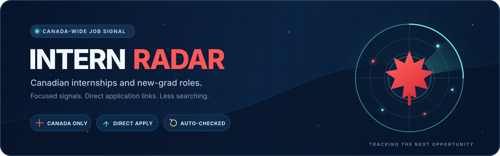

  

<h1 align="center">Canadian Internships &amp; New-Grad Roles - 2026</h1>

<strong>Canada-only internships, co-ops, and early-career roles - one overview, two focused lists.</strong>

  <a href="INTERNSHIPS.md#tech-internships"><strong>Tech internships</strong></a> 498 open
  &nbsp;&nbsp;-&nbsp;&nbsp;
  <a href="NEW_GRAD.md#tech-new-grad-roles"><strong>Tech new grad</strong></a> 90 open 
  <a href="INTERNSHIPS.md"><strong>All internships &amp; co-ops</strong></a> 1847 open
  &nbsp;&nbsp;-&nbsp;&nbsp;
  <a href="NEW_GRAD.md"><strong>All new grad &amp; early career</strong></a> 423 open

  <a href="CONTRIBUTING.md"><strong>Contributing</strong></a> -
  <a href="../../issues/new?template=suggest-listing.yml">Suggest or report a listing</a>

  
  
  
  
  

Last refreshed Nov 2, 2026 at 02:45 UTC

> [!TIP]
> 
<strong>Pick a list, then start with what changed.</strong> NEW marks roles posted in the last 7 days, and roles posted more than 180 days ago are hidden automatically. Every row is re-checked for a Canadian location before it is published.

## At a glance

| | Internships & co-ops | New grad & early career |
|---|---:|---:|
| Open roles | [1847](INTERNSHIPS.md) | [423](NEW_GRAD.md) |
| Tech roles | [498](INTERNSHIPS.md#tech-internships) | [90](NEW_GRAD.md#tech-new-grad-roles) |
| Other roles | [1349](INTERNSHIPS.md#other-internships) | [333](NEW_GRAD.md#other-early-career-roles) |
| Posted in the last 7 days | 345 | 50 |
| Hiring companies | 379 | 155 |
| Pay disclosed | 23% | 25% |
| Remote-friendly | 11 | 4 |
| Closed in the last 7 days | 209 | 27 |

## Newest roles

### Newest tech internships

**The 50 newest of 498 open tech internships**

| Company | Role | Location | Details | Posted | Apply |
|---|---|---|---|---:|---|
| Equitable Bank | NEW Data Scientist Intern | Toronto, ON | - | Nov 2, 2026 today | <a href="https://jobs.lever.co/eqbank/b152bad3-df48-4049-9d44-ba7e57ea6499/"><strong>Apply</strong></a> | <!--id:0-->
| Mila | NEW AI Safety Research Intern | Montreal, QC | - | Nov 2, 2026 today | <a href="https://apply.workable.com/mila-2/j/1E81635604/"><strong>Apply</strong></a> | <!--id:0-->
| Waterworth | NEW Computer Science Co-op (Winter 2027) | Victoria, BC | Winter 2027 - Co-op enrollment | Nov 2, 2026 today | <a href="https://apply.workable.com/waterworth/j/D450C48C96/"><strong>Apply</strong></a> | <!--id:0-->
| Cenovus Energy | NEW Student Risk Analytics Intern (Summer 2027) | Calgary, AB | Summer 2027 | Nov 2, 2026 today | <a href="https://cenovus.wd3.myworkdayjobs.com/careers/job/CA-AB-Calgary/Student--Risk-Analytics--Calgary--May-2027-_R-411263"><strong>Apply</strong></a> | <!--id:0-->
| Royal Bank of Canada | NEW Developer Intern, RBC Amplify (Summer 2027) | Montreal, QC | Summer 2027 | Nov 2, 2026 today | <a href="https://rbc.wd3.myworkdayjobs.com/rbcglobal1/job/MONTRAL-Quebec-Canada/dveloppeur--RBC-amplifie-2027--Montral---Developer--RBC-Amplify-2027--Montreal_R-0000191206"><strong>Apply</strong></a> | <!--id:0-->
| Royal Bank of Canada | NEW Data Engineer Intern, RBC Amplify (Summer 2027) | Calgary, AB | Summer 2027 | Nov 2, 2026 today | <a href="https://rbc.wd3.myworkdayjobs.com/rbcglobal1/job/CALGARY-Alberta-Canada/Data-Engineer--RBC-Amplify-2027--Calgary_R-0000191201-2"><strong>Apply</strong></a> | <!--id:0-->
| 1Password | NEW Developer Intern, Credential Brokering (Winter 2027) | Remote, Canada | Winter 2027 - Remote | Nov 2, 2026 today | <a href="https://jobs.ashbyhq.com/1password/67bfbd8b-aba9-42b1-a8a8-833367888fba/"><strong>Apply</strong></a> | <!--id:0-->
| 1Password | NEW Developer Intern, Developer Interfaces (Winter 2027) | Remote, Canada | Winter 2027 - Remote | Nov 2, 2026 today | <a href="https://jobs.ashbyhq.com/1password/00f861d4-2b4a-4159-b6dc-8aed0cde6e39/"><strong>Apply</strong></a> | <!--id:0-->
| Nutanix | NEW Software Developer Co-op (Winter 2027) | Vancouver, BC | Winter 2027 - Co-op enrollment | Nov 2, 2026 today | <a href="https://jobs.jobvite.com/nutanix/job/oiwZAfw7?nl=1&amp;nl=1&amp;fr=false"><strong>Apply</strong></a> | <!--id:0-->
| 1Password | NEW Developer Intern, Vault Team (Winter 2027) | Remote, Canada | Winter 2027 - Remote | Nov 2, 2026 today | <a href="https://jobs.ashbyhq.com/1password/b2726ac7-dd0d-42f3-93a5-139e18c90779/"><strong>Apply</strong></a> | <!--id:0-->
| 1Password | NEW Developer Intern, Front-End Platform (Winter 2027) | Remote, Canada | Winter 2027 - Remote | Nov 2, 2026 today | <a href="https://jobs.ashbyhq.com/1password/71a3afd1-12b3-4f55-a3bd-fc4e7c46ee37/"><strong>Apply</strong></a> | <!--id:0-->
| 1Password | NEW Developer Intern, Machine Identity (Winter 2027) | Remote, Canada | Winter 2027 - Remote | Nov 2, 2026 today | <a href="https://jobs.ashbyhq.com/1password/6a6869a7-98d2-43e3-b9b5-b68fa4daeb9f/"><strong>Apply</strong></a> | <!--id:0-->
| 1Password | NEW Developer Intern, Provisioning (Winter 2027) | Remote, Canada | Winter 2027 - Remote | Nov 2, 2026 today | <a href="https://jobs.ashbyhq.com/1password/c5289ef1-e919-4672-85c5-ee3112f9ddb9/"><strong>Apply</strong></a> | <!--id:0-->
| GeoSpectrum Technologies | NEW Software Developer Co-op | Dartmouth, NS | Co-op enrollment | Nov 2, 2026 today | <a href="https://geospectrum.bamboohr.com/careers/286/"><strong>Apply</strong></a> | <!--id:0-->
| HeyGen | NEW Software Engineer Intern (Winter 2027) | Toronto, ON | Winter 2027 | Nov 2, 2026 today | <a href="https://job-boards.greenhouse.io/heygen/jobs/4540716007"><strong>Apply</strong></a> | <!--id:0-->
| Electronic Arts | NEW AI/ML Software Engineer Co-op Intern (Summer 2027) | Vancouver, BC | Summer 2027 - 8 month term - Co-op enrollment | Nov 2, 2026 today | <a href="https://jobs.ea.com/en_US/careers/JobDetail/AI-ML-Software-Engineer-Intern-Summer-2027-8-Months-Masters-QVS/216234"><strong>Apply</strong></a> | <!--id:0-->
| D2L | NEW Software Developer Co-op, Custom Development Services (Winter 2027) | Kitchener, ON | Winter 2027 - Co-op enrollment | Nov 2, 2026 today | <a href="https://www.d2l.com/careers/jobs/?job_id=8289767&amp;gh_jid=8289767"><strong>Apply</strong></a> | <!--id:0-->
| Electronic Arts | NEW Analytics Intern (Summer 2027) | Vancouver, BC | Summer 2027 | Nov 2, 2026 today | <a href="https://jobs.ea.com/en_US/careers/JobDetail/Analytics-Intern/216232"><strong>Apply</strong></a> | <!--id:0-->
| TechInsights | NEW Software Development Co-op Student (Winter 2026) | Ottawa, ON | Winter 2026 - Co-op enrollment | Nov 2, 2026 today | <a href="https://techinsights.applytojob.com/apply/3yhis78252/Software-Development-Coop-Student-Winter-2026"><strong>Apply</strong></a> | <!--id:0-->
| Profound Medical | NEW Software Development Co-op | Mississauga, ON | Co-op enrollment | Nov 2, 2026 today | <a href="https://profoundmedical.bamboohr.com/careers/353/"><strong>Apply</strong></a> | <!--id:0-->
| Electronic Arts | NEW Software Engineer Intern (Summer 2027) | Vancouver, BC | Summer 2027 | Nov 2, 2026 today | <a href="https://jobs.ea.com/en_US/careers/JobDetail/Software-Engineer-Intern/216287"><strong>Apply</strong></a> | <!--id:0-->
| Databricks | NEW Software Engineer Intern (Summer 2027) | Vancouver, BC | Summer 2027 | Nov 2, 2026 today | <a href="https://www.databricks.com/company/careers/university-recruiting---engineering/software-engineering-intern-2027-6865687002"><strong>Apply</strong></a> | <!--id:0-->
| Electronic Arts | NEW Gameplay Software Engineer Co-op (Summer 2027) | Vancouver, BC | Summer 2027 - Co-op enrollment | Nov 2, 2026 today | <a href="https://jobs.ea.com/en_US/careers/JobDetail/Software-Engineer-Co-op/216230"><strong>Apply</strong></a> | <!--id:0-->
| Electronic Arts | NEW C++ Software Engineer Intern (Summer 2027) | Vancouver, BC | Summer 2027 - 8 month term | Nov 2, 2026 today | <a href="https://jobs.ea.com/en_US/careers/JobDetail/Software-Engineer-Intern-Summer-2027-8-months-UFC/216226"><strong>Apply</strong></a> | <!--id:0-->
| Electronic Arts | NEW C++ Generalist Software Engineer Co-op (Summer 2027) | Vancouver, BC | Summer 2027 - Co-op enrollment | Nov 2, 2026 today | <a href="https://jobs.ea.com/en_US/careers/JobDetail/Software-Engineer-Co-op/216231"><strong>Apply</strong></a> | <!--id:0-->
| Pinterest | NEW Software Engineering Intern | Toronto, ON | - | Nov 2, 2026 today | <a href="https://www.pinterestcareers.com/jobs/8138039/software-engineering-intern-2027-toronto/?gh_jid=8138039"><strong>Apply</strong></a> | <!--id:0-->
| Electronic Arts | NEW Software Engineer Intern | Vancouver, BC | - | Nov 2, 2026 today | <a href="https://jobs.ea.com/en_US/careers/JobDetail/Software-Engineer-Intern/216227"><strong>Apply</strong></a> | <!--id:0-->
| Acuity | NEW Firmware Development Intern | Brossard, QC | - | Nov 2, 2026 today | <a href="https://careers.acuityinc.com/job/Brossard-Stage-en-d%C3%A9veloppement-micrologicielfirmware-Qu%C3%A9b-J4Y-0C4/1434107300/?ats=successfactors"><strong>Apply</strong></a> | <!--id:0-->
| Acuity | NEW Hardware Development Intern | Brossard, QC | - | Nov 2, 2026 today | <a href="https://careers.acuityinc.com/job/Brossard-Stagiaire-d%C3%A9veloppement-mat%C3%A9riel-(hardware"><strong>Apply</strong></a> | <!--id:0-->
| Analog Devices | NEW Embedded Software Engineer Intern | Toronto, ON / Vancouver, BC | - | Nov 2, 2026 today | <a href="https://analogdevices.wd1.myworkdayjobs.com/External/job/Canada-Toronto/Embedded-Software-Engineer_R266615"><strong>Apply</strong></a> | <!--id:0-->
| Electronic Arts | NEW AI Engineer Intern (Summer 2027) | Vancouver, BC | Summer 2027 | Nov 2, 2026 today | <a href="https://jobs.ea.com/en_US/careers/JobDetail/AI-Engineer/216236"><strong>Apply</strong></a> | <!--id:0-->
| Amazon | NEW Software Development Engineer Intern | Vancouver, BC | - | Nov 2, 2026 today | <a href="https://amazon.jobs/en/jobs/10553947/software-development-engineer-intern-summer-2027-can"><strong>Apply</strong></a> | <!--id:0-->
| TRC Companies | NEW Software Engineer Intern | Calgary, AB | - | Nov 2, 2026 today | <a href="https://careers.trccompanies.com/jobs/26840?icims=1"><strong>Apply</strong></a> | <!--id:0-->
| L3Harris Technologies | NEW Software Engineer Co-op | Waterdown, ON | Co-op enrollment | Nov 2, 2026 today | <a href="https://jobs.l3harris.com/job/Waterdown-Software-Engineering-Co-Op-(Waterdown,-CAN"><strong>Apply</strong></a> | <!--id:0-->
| L3Harris Technologies | NEW FPGA Software Tool Developer Co-op | Waterdown, ON | Co-op enrollment | Nov 2, 2026 today | <a href="https://jobs.l3harris.com/job/Waterdown-FPGA-Software-Tool-Developer-Co-Op-(Waterdown,-CAN"><strong>Apply</strong></a> | <!--id:0-->
| L3Harris Technologies | NEW Full Stack Developer Co-op | Waterdown, ON | Co-op enrollment | Nov 2, 2026 today | <a href="https://jobs.l3harris.com/job/Niagara-on-the-Lake-Full-Stack-Developer-Co-op-1-ON/1430141300/?ats=successfactors"><strong>Apply</strong></a> | <!--id:0-->
| L3Harris Technologies | NEW FPGA Designer Co-op | Hamilton, ON | Co-op enrollment | Nov 2, 2026 today | <a href="https://jobs.l3harris.com/job/Waterdown-FPGA-Designer-Coop-(Waterdown,-CAN"><strong>Apply</strong></a> | <!--id:0-->
| Nexthop.ai | NEW Software Engineer Intern | Burnaby, BC | - | Nov 2, 2026 today | <a href="https://nexthopai.bamboohr.com/careers/64/"><strong>Apply</strong></a> | <!--id:0-->
| Microsoft | NEW Software Engineer Intern | Vancouver, BC | - | Nov 2, 2026 today | <a href="https://apply.careers.microsoft.com/careers/job/1970393556991773?hl=en"><strong>Apply</strong></a> | <!--id:0-->
| Dialogue | NEW Full Stack Developer Intern | Montreal, QC | - | Nov 2, 2026 today | <a href="https://ats.rippling.com/dialogue-en/jobs/3c2341d5-604d-463c-8b79-5d1669d81e78"><strong>Apply</strong></a> | <!--id:0-->
| Amazon | NEW Machine Learning Systems Software Development Engineer Intern, Annapurna Labs | Toronto, ON | - | Nov 2, 2026 today | <a href="https://amazon.jobs/en/jobs/10538066/ml-systems-software-development-engineer-intern-annapurna-labs-2027"><strong>Apply</strong></a> | <!--id:0-->
| Grass Valley | NEW Software Development Intern | Montreal, QC | - | Nov 2, 2026 today | <a href="https://grassvalley.applytojob.com/apply/r0V942NWEh/Stagiaire-Dveloppement-De-Logiciel-C-Intern-Software-Development-C"><strong>Apply</strong></a> | <!--id:0-->
| Pomerleau | NEW GIS Data Analyst Intern | Montreal, QC | - | Nov 2, 2026 today | <a href="https://pomerleau.avature.net/en_US/Jobs/JobDetail/3695"><strong>Apply</strong></a> | <!--id:0-->
| Zaber Technologies | NEW Software Developer Co-op | Vancouver, BC | Co-op enrollment | Nov 2, 2026 today | <a href="https://apply.workable.com/zaber/j/EAB5877DC3/"><strong>Apply</strong></a> | <!--id:0-->
| Zaber Technologies | NEW Embedded Software Co-op | Vancouver, BC | Co-op enrollment | Nov 2, 2026 today | <a href="https://apply.workable.com/zaber/j/1F627CC2BB/"><strong>Apply</strong></a> | <!--id:0-->
| General Dynamics UK | NEW Software Engineering Co-op | Cole Harbour, NS | Co-op enrollment | Nov 2, 2026 today | <a href="https://jobs.smartrecruiters.com/GDMSI/744000147583700"><strong>Apply</strong></a> | <!--id:0-->
| General Dynamics UK | NEW Software Engineer Co-op | Ottawa, ON | Co-op enrollment | Nov 2, 2026 today | <a href="https://jobs.smartrecruiters.com/GDMSI/744000147019949"><strong>Apply</strong></a> | <!--id:0-->
| Atlassian | NEW Software Engineer Intern | Burnaby, BC / Vancouver, BC / Richmond, BC | - | Nov 2, 2026 today | <a href="https://campus-globalcareers-atlassian.icims.com/jobs/26275/software-engineer-intern%2c-2027-canada/job"><strong>Apply</strong></a> | <!--id:0-->
| AMD | NEW Hardware Design Verification Engineer Intern/Co-op | Markham, ON | Co-op enrollment | Nov 2, 2026 today | <a href="https://careers.amd.com/jobs/91361?icims=1"><strong>Apply</strong></a> | <!--id:0-->
| General Dynamics UK | NEW Software Developer Co-op | Calgary, AB | Co-op enrollment | Nov 2, 2026 today | <a href="https://jobs.smartrecruiters.com/GDMSI/744000146985399"><strong>Apply</strong></a> | <!--id:0-->

<a href="INTERNSHIPS.md#tech-internships"><strong>See all 498 tech internships</strong></a> - <a href="INTERNSHIPS.md"><strong>Browse every internship &amp; co-op</strong></a> 1847 open

### Newest tech new-grad roles

**The 50 newest of 90 open tech new-grad roles**

| Company | Role | Location | Details | Posted | Apply |
|---|---|---|---|---:|---|
| DraftKings | NEW Software Engineer (December 2026 Grads) | Remote - Canada | - | Oct 30, 2026 3 days old | <a href="https://draftkings.wd1.myworkdayjobs.com/Employee_Referral_Portal/job/Remote---Canada/Software-Engineer--December-2026-Grads-_JR15324-1"><strong>Apply</strong></a> | <!--id:322682-->
| Kent Building Supplies | NEW Junior Data Analyst | Halifax, NS, Canada | - | Oct 30, 2026 3 days old | <a href="https://hcpd.fa.ca2.oraclecloud.com/hcmUI/CandidateExperience/en/sites/Careers/job/13080"><strong>Apply</strong></a> | <!--id:322732-->
| Fleetway | NEW Junior Data Analyst | Halifax, NS, Canada | - | Oct 30, 2026 3 days old | <a href="https://hcpd.fa.ca2.oraclecloud.com/hcmUI/CandidateExperience/en/sites/CX_1/job/13080"><strong>Apply</strong></a> | <!--id:322731-->
| Ciena | NEW Photonic Card Software Developer - New Grad | Ottawa, Canada- Ottawa- 385 Terry Fox- Bldg B | $68.8K-$109.8K/yr - Portfolio / GitHub | Oct 29, 2026 4 days old | <a href="https://ciena.wd5.myworkdayjobs.com/Careers/job/Ottawa/Experienced-Photonic-Card-Software-Developer_R031379"><strong>Apply</strong></a> | <!--id:322620-->
| SOTI | NEW Associate Software Development Engineer in Test (SDET) | Mississauga, Canada - Meadowvale Office (HQ) | Hybrid / on-site - Portfolio / GitHub | Oct 29, 2026 4 days old | <a href="https://soti.wd3.myworkdayjobs.com/Careers/job/Mississauga-Canada--Meadowvale-Office-HQ/Associate-Software-Development-Engineer-in-Test--SDET-_R10624"><strong>Apply</strong></a> | <!--id:322594-->
| Valtech | NEW Jr. AI Native Engineer | Canada | Portfolio / GitHub | Oct 29, 2026 4 days old | <a href="https://www.linkedin.com/jobs/view/4484782857"><strong>Apply</strong></a> | <!--id:0-->
| Hootsuite | NEW Junior Cyber Incident Response Analyst | Vancouver, British Columbia, Canada; Toronto, Ontario, Canada; Ottawa, Ontario, Canada | $68K-$95K CAD - Hybrid / on-site | Oct 28, 2026 5 days old | <a href="https://job-boards.greenhouse.io/hootsuite/jobs/8331544"><strong>Apply</strong></a> | <!--id:322566-->
| Ciena | NEW Routing/IP Software Engineer  - New Grad | Ottawa, Canada- Ottawa- 385 Terry Fox- Bldg B | $71.9K-$114.9K/yr - Co-op enrollment - Hybrid / on-site - Portfolio / GitHub | Oct 28, 2026 5 days old | <a href="https://ciena.wd5.myworkdayjobs.com/Careers/job/Ottawa/Routing-IP-Software-Engineer----New-Grad_R032006"><strong>Apply</strong></a> | <!--id:322517-->
| American Express | NEW Campus Graduate Full-Time Engineer - 2027 AI Engineering, Enterprise Technology Services- Toronto, Ontario, CN | Toronto, ON, Canada | - | Oct 28, 2026 5 days old | <a href="https://egug.fa.us2.oraclecloud.com/hcmUI/CandidateExperience/en/sites/CX_1/job/26015465"><strong>Apply</strong></a> | <!--id:322551-->
| Deloitte | NEW Junior Software Engineer | Toronto, Ontario, Canada | $58K-$96K/yr - Hybrid / on-site - Portfolio / GitHub | Oct 28, 2026 5 days old | <a href="https://www.linkedin.com/jobs/view/4484496029"><strong>Apply</strong></a> | <!--id:0-->
| Hunter Bond | NEW Graduate Quant Developer / Quant Researcher - Up to $150,000 + Bonus + Benefits | Montreal, Quebec, Canada | $150K/yr - Hybrid / on-site | Oct 28, 2026 5 days old | <a href="https://www.linkedin.com/jobs/view/4482541843"><strong>Apply</strong></a> | <!--id:0-->
| Tower Research Capital | NEW Developpeur de logiciels C++ nouvellement diplome / New Grad C++ Software Developer | Montreal, Quebec, Canada | - | Oct 28, 2026 5 days old | <a href="https://www.linkedin.com/jobs/view/4466523490"><strong>Apply</strong></a> | <!--id:0-->
| Royal Bank of Canada | NEW developpeur, RBC amplifie 2027, Montreal / Developer, RBC Amplify 2027, Montreal | MONTREAL, Quebec, Canada, 1 PLACE VILLE MARIE:MONTREAL | - | Oct 26, 2026 7 days old | <a href="https://rbc.wd3.myworkdayjobs.com/RBCEARLYTALENT1/job/MONTRAL-Quebec-Canada/dveloppeur--RBC-amplifie-2027--Montral---Developer--RBC-Amplify-2027--Montreal_R-0000191206-1"><strong>Apply</strong></a> | <!--id:322399-->
| Royal Bank of Canada | NEW Data Engineer, RBC Amplify 2027, Toronto | TORONTO, Ontario, Canada, 180 WELLINGTON ST W:TORONTO | Co-op enrollment - Graduating 2027 - Student status | Oct 26, 2026 7 days old | <a href="https://rbc.wd3.myworkdayjobs.com/RBCEARLYTALENT1/job/TORONTO-Ontario-Canada/Data-Engineer--RBC-Amplify-2027--Toronto_R-0000191192-1"><strong>Apply</strong></a> | <!--id:322402-->
| Walmart | NEW (CAN) Asset Protection Associate SECURITY LICENSE REQUIRED | (CAN) ON SCARBOROUGH 03159 WM SUPERCENTER | - | Oct 26, 2026 7 days old | <a href="https://walmart.wd504.myworkdayjobs.com/WalmartExternal/job/CAN-ON-SCARBOROUGH-03159-WM-SUPERCENTER/XMLNAME--CAN--Asset-Protection-Associate-SECURITY-LICENSE-REQUIRED_R-2689051"><strong>Apply</strong></a> | <!--id:322376-->
| Royal Bank of Canada | NEW Developer, RBC Amplify 2027, Vancouver | VANCOUVER, British Columbia, Canada, 410 GEORGIA ST W, FLOOR 3:VANCOUVER | Co-op enrollment - Graduating 2027 - Student status | Oct 26, 2026 7 days old | <a href="https://rbc.wd3.myworkdayjobs.com/RBCEARLYTALENT1/job/VANCOUVER-British-Columbia-Canada/Developer--RBC-Amplify-2027--Vancouver_R-0000191199"><strong>Apply</strong></a> | <!--id:322361-->
| Royal Bank of Canada | NEW Developer, RBC Amplify 2027, Calgary | CALGARY, Alberta, Canada, 335 8 AVE SW:CALGARY | Co-op enrollment - Graduating 2027 - Student status | Oct 26, 2026 7 days old | <a href="https://rbc.wd3.myworkdayjobs.com/RBCEARLYTALENT1/job/CALGARY-Alberta-Canada/Developer--RBC-Amplify-2027--Calgary_R-0000191202-1"><strong>Apply</strong></a> | <!--id:322358-->
| Royal Bank of Canada | NEW Developer, RBC Amplify 2027, Toronto | TORONTO, Ontario, Canada, 180 WELLINGTON ST W:TORONTO | Co-op enrollment - Graduating 2027 - Student status | Oct 26, 2026 7 days old | <a href="https://rbc.wd3.myworkdayjobs.com/RBCEARLYTALENT1/job/TORONTO-Ontario-Canada/Developer--RBC-Amplify-2027--Toronto_R-0000191193-1"><strong>Apply</strong></a> | <!--id:322357-->
| Royal Bank of Canada | NEW Data Engineer, RBC Amplify 2027, Calgary | CALGARY, Alberta, Canada, 335 8 AVE SW:CALGARY | Co-op enrollment - Graduating 2027 - Student status | Oct 26, 2026 7 days old | <a href="https://rbc.wd3.myworkdayjobs.com/RBCEARLYTALENT1/job/CALGARY-Alberta-Canada/Data-Engineer--RBC-Amplify-2027--Calgary_R-0000191201"><strong>Apply</strong></a> | <!--id:322359-->
| Linamar | Automation Technician, Junior | Guelph, ON, Canada | - | Oct 26, 2026 7 days old | <a href="https://fa-epmd-saasfaprod1.fa.ocs.oraclecloud.com/hcmUI/CandidateExperience/en/sites/CX_3001/job/14694"><strong>Apply</strong></a> | <!--id:322405-->
| Glowtify | Junior Software Developer, Product &amp; AI | Montreal, Quebec, Canada | French / bilingual | Oct 26, 2026 7 days old | <a href="https://www.linkedin.com/jobs/view/4482698664"><strong>Apply</strong></a> | <!--id:0-->
| Why Hiring | Jr. Data Scientist | Canada | - | Oct 26, 2026 7 days old | <a href="https://www.linkedin.com/jobs/view/4481426285"><strong>Apply</strong></a> | <!--id:0-->
| Johnson Controls | Associate IT Operations Engineer | Nisku-Alberta-Canada, SA - Nisku Aries 1 | $73K-$90K/yr - Hybrid / on-site | Oct 25, 2026 8 days old | <a href="https://jci.wd5.myworkdayjobs.com/jci/job/Nisku-Alberta-Canada/Associate-IT-Operations-Engineer_WD30283006"><strong>Apply</strong></a> | <!--id:322403-->
| Ciena | Hardware Engineer - New Grad | Ottawa, Canada- Ottawa- 383 Terry Fox- Bldg C | Co-op enrollment | Oct 23, 2026 10 days old | <a href="https://ciena.wd5.myworkdayjobs.com/Careers/job/Ottawa/Hardware-Engineer---New-Grad_R031914"><strong>Apply</strong></a> | <!--id:322243-->
| Agility PR Solutions | Junior Software Developer (Content Integration &amp; Data Pipelines) | Ottawa, Canada | $65K-$75K/yr - Talent pool | Oct 23, 2026 10 days old | <a href="https://ats.rippling.com/agilitypr/jobs/c8659284-b825-4008-8ddb-8b98d6368989"><strong>Apply</strong></a> | <!--id:322275-->
| Konrad | Associate Data Analyst | Toronto | $70K-$80K/yr - Hybrid / on-site | Oct 23, 2026 10 days old | <a href="https://www.konrad.com/careers/job/8043218003?gh_jid=8043218003"><strong>Apply</strong></a> | <!--id:322278-->
| GE Vernova | Candidat(e) a la profession d&#39;ingenieur en automatisation / EIT Automation Engineer | Longueuil QC CA 2 | - | Oct 23, 2026 10 days old | <a href="https://gevernova.wd5.myworkdayjobs.com/vernova_externalsite/job/Longueuil-QC-CA-2/Candidat-e---la-profession-d-ingnieur-en-automatisation---EIT-Automation-Engineer_R5056584-1"><strong>Apply</strong></a> | <!--id:322204-->
| BDO Canada | New Grad: Junior IT/IS Auditor, Technology Risk Assurance (Toronto or Calgary) | 2 Locations, Toronto Bay St | - | Oct 22, 2026 11 days old | <a href="https://bdo.wd3.myworkdayjobs.com/BDO/job/Toronto---Bay-St/New-Grad--Junior-IT-IS-Auditor--Technology-Risk-Assurance--Toronto-or-Calgary-_JR7262"><strong>Apply</strong></a> | <!--id:322178-->
| BMO | Climate Risk Analytics &amp; Reporting, Analyst ( New or Recent Graduate Opportunity) Immediate Start Date | Toronto, ON, CAN, FCP | $55.5K-$120K/yr - Student status - Portfolio / GitHub - Possible repost | Oct 22, 2026 11 days old | <a href="https://bmo.wd3.myworkdayjobs.com/Campus/job/Toronto-ON-CAN/Climate-Risk-Analytics---Reporting--Analyst---New-or-Recent-Graduate-Opportunity--Immediate-Start-Date_R260028351"><strong>Apply</strong></a> | <!--id:322177-->
| Aptiv | Associate Cloud Engineer | CAN Kanata (2), ON - WR | $65K-$80K/yr | Oct 22, 2026 11 days old | <a href="https://aptiv.wd5.myworkdayjobs.com/aptiv_careers/job/CAN-Kanata-2-ON---WR/Associate-Engineer---Cloud---CD1_J000701887"><strong>Apply</strong></a> | <!--id:322336-->
| TD Bank | Software Engineer I - Full Stack | 2 Locations, Mississauga Ontario | - | Oct 21, 2026 12 days old | <a href="https://td.wd3.myworkdayjobs.com/TD_Bank_Careers/job/Mississauga-Ontario/Software-Engineer-I---Full-Stack_R_1516937"><strong>Apply</strong></a> | <!--id:322065-->
| FDM Group | Junior Software Engineer | Halifax, Nova Scotia, Canada | $18.35/hr - 12 week term - Canadian work authorization - Hybrid / on-site | Oct 21, 2026 12 days old | <a href="https://www.linkedin.com/jobs/view/4482174745"><strong>Apply</strong></a> | <!--id:0-->
| GuestTek Interactive Entertainment Ltd. | Junior Software Developer | Calgary, Alberta, Canada | Hybrid / on-site | Oct 21, 2026 12 days old | <a href="https://www.linkedin.com/jobs/view/4479429596"><strong>Apply</strong></a> | <!--id:0-->
| Agility PR Solutions | Junior AI Software Developer | Ottawa, Ontario, Canada | $65K-$75K/yr | Oct 21, 2026 12 days old | <a href="https://www.linkedin.com/jobs/view/4482191208"><strong>Apply</strong></a> | <!--id:0-->
| TD | Software Engineer I - Full Stack | Mississauga, Ontario, Canada | $69.7K-$98.4K/yr - Assessment likely | Oct 21, 2026 12 days old | <a href="https://www.linkedin.com/jobs/view/4482171540"><strong>Apply</strong></a> | <!--id:0-->
| CGI | Developpeur .NET JR | Quebec, Quebec, Canada | - | Oct 21, 2026 12 days old | <a href="https://www.linkedin.com/jobs/view/4482160757"><strong>Apply</strong></a> | <!--id:0-->
| Quora | Full Stack Software Engineer, New Grad - Quora (Remote) | Remote - Multiple Locations, United States, Canada | $97.6K-$139K/yr - Graduating 2026 - Possible repost | Oct 20, 2026 13 days old | <a href="https://jobs.ashbyhq.com/quora/5494e6a1-a973-46af-b9f3-57208eb91b52"><strong>Apply</strong></a> | <!--id:321957-->
| General Dynamics Mission Systems | Junior Systems Engineer - Networking | Ottawa, ON, Canada | - | Oct 20, 2026 13 days old | <a href="https://jobs.smartrecruiters.com/GDMSI/744000156643355"><strong>Apply</strong></a> | <!--id:321943-->
| Bank of Montreal | Specialist II-IC Infrastructure Engineering (New or Recent Graduate) | Barrie, ON, CAN, BCC | $55.5K-$120K/yr - Co-op enrollment - Hybrid / on-site - Student status | Oct 20, 2026 13 days old | <a href="https://bmo.wd3.myworkdayjobs.com/External/job/Barrie-ON-CAN/Specialist-II-IC-Infrastructure-Engineering--New-or-Recent-Graduate-_R260028509-1"><strong>Apply</strong></a> | <!--id:321889-->
| GIRO | Junior C++ Developer | Montreal, Rosemont | - | Oct 19, 2026 14 days old | <a href="https://giro.wd10.myworkdayjobs.com/GIRO/job/Montreal-Rosemont/Dveloppeur-ou-Dveloppeuse-C---junior_R-100000346"><strong>Apply</strong></a> | <!--id:321872-->
| Cenovus Energy | New Grad, Process Data Solutions, Calgary (June 2027) | CA-AB-Calgary, Calgary | 12 month term - Canadian work authorization - Talent pool | Oct 19, 2026 14 days old | <a href="https://cenovus.wd3.myworkdayjobs.com/careers/job/CA-AB-Calgary/New-Grad--Process-Data-Solutions--Calgary--June-2027-_R-411229-1"><strong>Apply</strong></a> | <!--id:321904-->
| Amazon | Software Development Engineer, Early Career - 2027 (CAN) | Vancouver, British Columbia, Canada | - | Oct 19, 2026 14 days old | <a href="https://www.amazon.jobs/en/jobs/10583004"><strong>Apply</strong></a> | <!--id:321873-->
| Veriforce Canada | Jr. QA Engineer | Montreal, Quebec, Canada | Hybrid / on-site | Oct 19, 2026 14 days old | <a href="https://www.linkedin.com/jobs/view/4480980548"><strong>Apply</strong></a> | <!--id:0-->
| Ontario Power Generation | Junior Software Engineer, Full Stack | Oshawa, Ontario, Canada | - | Oct 19, 2026 14 days old | <a href="https://www.linkedin.com/jobs/view/4478294281"><strong>Apply</strong></a> | <!--id:0-->
| BDO Canada | Analyste d&#39;affaires, Donnees et analytique - Nouveau diplome (janvier 2027) | Toronto, Ontario, Canada | - | Oct 18, 2026 15 days old | <a href="https://www.linkedin.com/jobs/view/4477635114"><strong>Apply</strong></a> | <!--id:0-->
| Affirm | Software Engineer I, Fullstack (Search) | Remote Canada | $101K-$151K/yr - Remote | Oct 15, 2026 18 days old | <a href="https://job-boards.greenhouse.io/affirm/jobs/8017342003"><strong>Apply</strong></a> | <!--id:321647-->
| IQVIA | Scientifique des donnees associe, confidentialite et desidentification/ Associate Data Scientist, Privacy and De-identification | Ottawa, Ontario, Canada | - | Oct 15, 2026 18 days old | <a href="https://iqvia.wd1.myworkdayjobs.com/IQVIA/job/Ottawa-Ontario-Canada/Scientifique-des-donnes-associ--confidentialit-et-dsidentification--Associate-Data-Scientist--Privacy-and-De-identification_R1569257"><strong>Apply</strong></a> | <!--id:321631-->
| Quora | Machine Learning Engineer, New Grad - Quora (Remote) | Remote - Multiple Locations, United States, Canada | $107.36K-$152.9K/yr - Possible repost | Oct 15, 2026 18 days old | <a href="https://jobs.ashbyhq.com/quora/40659fe7-545e-4b08-b6d7-2567b18b9ed3"><strong>Apply</strong></a> | <!--id:321583-->
| AlgaeCal | Associate Data Scientist | Vancouver, British Columbia, Canada | - | Oct 15, 2026 18 days old | <a href="https://apply.workable.com/algaecal/j/6AD2FD571B/"><strong>Apply</strong></a> | <!--id:321650-->
| OTI Lumionics | Junior Mechatronics Engineer | Mississauga, ON | $65K-$90K CAD - Hybrid / on-site | Oct 13, 2026 20 days old | <a href="https://jobs.lever.co/otilumionics/9b13354b-35de-4e13-96c0-36d8f28a0fa2"><strong>Apply</strong></a> | <!--id:321391-->

<a href="NEW_GRAD.md#tech-new-grad-roles"><strong>See all 90 tech new-grad roles</strong></a> - <a href="NEW_GRAD.md"><strong>Browse every new-grad &amp; early-career role</strong></a> 423 open

## Where the roles are

| City or region | Internships | New grad |
|---|---:|---:|
| Greater Toronto Area | 663 | 134 |
| Greater Montreal | 347 | 46 |
| Metro Vancouver | 144 | 42 |
| Calgary | 115 | 47 |
| Ottawa-Gatineau | 105 | 36 |
| Waterloo Region | 60 | 6 |
| Edmonton | 26 | 20 |
| Halifax | 27 | 17 |
| Winnipeg | 14 | 7 |
| Quebec City | 2 | 0 |
| Remote-friendly | 11 | 4 |
| Other Canadian locations | 416 | 109 |

A role that lists several places counts once in each.

## Most active employers

| Company | Internships | New grad | Total |
|---|---:|---:|---:|
| Bombardier | 200 | 2 | 202 |
| PepsiCo Canada | 34 | 21 | 55 |
| Stantec | 20 | 29 | 49 |
| Canadian Natural | 48 | 0 | 48 |
| RTX | 40 | 3 | 43 |
| Royal Bank of Canada | 33 | 9 | 42 |
| CIBC | 40 | 0 | 40 |
| MNP | 39 | 1 | 40 |
| AtkinsRealis | 16 | 19 | 35 |
| Qualcomm | 35 | 0 | 35 |

## Upcoming internship terms

| Term | Open internships |
|---|---:|
| Fall 2026 | 9 |
| Fall/Winter 2026 | 2 |
| Winter 2027 | 573 |
| Winter/Spring 2027 | 1 |
| Winter/Summer 2027 | 6 |
| Spring 2027 | 7 |
| Summer 2027 | 194 |
| Summer/Fall 2027 | 1 |

<strong>How Intern Radar keeps the list useful</strong>

- **Source-aware:** links point to the employer's application page when available, otherwise to the original public posting.
- **Canada-first:** location eligibility is checked again at publish time, not just when a role is discovered.
- **Honest dates:** the employer's posting date is shown with its age; when unavailable, the first time the radar detected the role is used.
- **Fresh by default:** roles posted more than 180 days ago drop off every list automatically.
- **Useful details:** disclosed pay, term, eligibility, and application requirements are extracted into short, readable signals.
- **Closure tracking:** recently removed roles stay available in collapsed sections instead of overwhelming the active list.

  <a href="INTERNSHIPS.md"><strong>All internships &amp; co-ops</strong></a> 1847 open
  &nbsp;&nbsp;-&nbsp;&nbsp;
  <a href="NEW_GRAD.md"><strong>All new grad &amp; early career</strong></a> 423 open

---

  <strong>Found a missing, closed, or incorrect role?</strong> 
  <a href="../../issues/new?template=suggest-listing.yml">Send a one-minute listing report</a> - <a href="CONTRIBUTING.md">Contribution guide</a>  
  Star or watch the repository to keep the radar close when recruiting season moves fast.

